# UD1: Interfaces de usuario. Características y usabilidad

 

**Contenidos**
---

1. [Interacción persona-ordenador (IPO)](#1-interacción-persona-ordenador-ipo)
2. [Perfiles y proceso de diseño](#2-perfiles-y-proceso-de-diseño)
3. [Fundamentos del diseño visual](#3-fundamentos-del-diseño-visual)
4. [El color](#4-el-color)
5. [Tipografía e iconografía](#5-tipografía-e-iconografía)
6. [Componentes de una interfaz](#6-componentes-de-una-interfaz)
7. [Prototipado y herramientas](#7-prototipado-y-herramientas)
8. [Usabilidad](#8-usabilidad)
9. [Pautas de diseño y accesibilidad](#9-pautas-de-diseño-y-accesibilidad)

## 1. Interacción persona-ordenador (IPO)

La **Interacción Persona-Ordenador** (IPO, o *HCI, Human-Computer Interaction*) es el campo que analiza cómo se comunican las personas con los sistemas informáticos. Busca que esa comunicación resulte cada vez más eficaz: con menos errores, menos esfuerzo para quien usa el sistema y mayor grado de satisfacción.

No es un campo nuevo: ya en los años 60 y 70 se identificaron problemas y principios que, salvando las distancias tecnológicas, se siguen aplicando hoy en cualquier interfaz, ya sea de escritorio, web o móvil.

### 1.1 Problemas más comunes a resolver

En 1962, Licklider y Clark identificaron cuatro dificultades principales en el diálogo entre personas y máquinas:

- **Intercambio de datos de entrada y salida** tanto simbólicos como gráficos.
- **Sistemas capaces de almacenar grandes volúmenes** de información.
- **Colaboración sencilla** entre quienes diseñan y quienes programan.
- **Comprensión del lenguaje natural**, tanto en su sintaxis como en su semántica.

### 1.2 Principios para el diseño de sistemas interactivos

En 1971, Hansen formuló un conjunto de principios que aún hoy sirven de punto de partida para diseñar una buena interfaz:

1. **Conocer al usuario.** Diseñar pensando en quién va a usar realmente la aplicación, sus conocimientos y necesidades.
2. **Minimizar la memorización**, por ejemplo:
   - Ofreciendo elegir entre opciones (listas, desplegables) para que el usuario no tenga que escribir ni recordar los valores.
   - Empleando nombres descriptivos y no cifras ni claves.
   - Procurando que la interfaz se comporte de forma previsible.
   - Dando acceso inmediato a datos útiles sobre el sistema (ayuda, atajos).
3. **Agilizar las operaciones**:
   - Que las tareas más frecuentes se completen deprisa.
   - Mantener la coherencia en toda la interfaz.
   - Reordenar la información según el uso real que se observe en los usuarios.
4. **Redactar mensajes de error útiles.**
5. **Prevenir los fallos más habituales desde el diseño**, y no limitarse a avisar cuando ya han ocurrido.
6. **Permitir deshacer** lo que se ha hecho.
7. **Proteger la integridad del sistema** ante averías, ya sean del programa o del equipo.

> Estos principios reaparecerán, con otro lenguaje, en las heurísticas de Nielsen que veremos en el apartado de [usabilidad](#8-usabilidad) — no es casualidad: son la misma idea madurada casi 30 años después.

### 1.3 Estándares de facto

Con el tiempo, muchas de las soluciones que fueron surgiendo para resolver estos problemas se han convertido en **estándares de facto**: normas que ningún organismo ha impuesto, pero que la mayoría acepta y aplica porque el usuario ya las espera encontrar (por ejemplo, que el logotipo lleve a la página de inicio, o que el icono de una papelera sirva para borrar). Diseñar respetando estos estándares reduce la curva de aprendizaje de cualquier interfaz nueva.

## 2. Perfiles y proceso de diseño

### 2.1 UX vs UI: dos perfiles, un mismo objetivo

Es habitual confundir estos dos perfiles porque trabajan codo con codo, pero cada uno se centra en un aspecto distinto del diseño de una interfaz:

| Perfil | Se centra en... | Funciones típicas |
| --- | --- | --- |
| **UX Designer** (*User Experience*) | Cómo se **siente** el usuario usando el producto: la experiencia global | Investigación de usuarios, arquitectura de la información, wireframing y prototipado, pruebas de usabilidad, documentación de diseño |
| **UI Designer** (*User Interface*) | Cómo se **ve** el producto: el aspecto, la interacción y la facilidad de uso visual | Estilo visual (fuentes, colores, gráficos), guías de estilo, diseño de los elementos de interacción |

Un ejemplo con la misma tarea: **dar cita** en la aplicación de escritorio de la recepción de una clínica veterinaria.

**La diseñadora UX:**

- Pasa una mañana en la recepción observando y entrevista a las tres recepcionistas. Descubre que casi todas las citas se dan **por teléfono**, con el auricular en una mano, y que buscan al cliente **por su número de teléfono**, no por su nombre.
- Rehace el flujo: de 5 pantallas (cliente → mascotas → servicio → calendario → confirmación) a **una sola ventana** en la que se busca por teléfono, se elige la mascota y se elige un hueco libre, todo **con el teclado**.
- Dibuja el wireframe y lo prueba con las recepcionistas: dar una cita pasa de unos 90 segundos a unos 30.

**El diseñador UI**, sobre ese mismo wireframe:

- Elige la paleta: las citas urgentes van en rojo y con un icono, para no depender solo del color. Fija la tipografía (Segoe UI, 14 px) y el espaciado en múltiplos de 8.
- Diseña los estados de cada control (normal, con el ratón encima, deshabilitado y con el foco visible), imprescindibles en una aplicación que se usa con el teclado.
- Diseña la «tarjeta de cita» del calendario (hora, mascota, motivo e icono de urgencia) y la añade al UI Kit como componente reutilizable.

En resumen: la UX decide **qué** hay en la ventana y **en qué orden** se hace la tarea; la UI decide **cómo se ve** y cómo responde cada elemento. Si falla la UX, la aplicación es bonita pero lenta de usar; si falla la UI, el flujo es bueno pero cuesta leerlo.

Ambos perfiles suelen recurrir a programas como Figma o Sketch para elaborar y compartir sus prototipos, y colaboran estrechamente con el equipo de desarrollo para que el resultado final sea fiel al diseño.

### 2.2 Los 10 principios de buen diseño (Dieter Rams)

El diseñador industrial Dieter Rams resumió en 10 principios lo que, para él, define un buen diseño. Aunque están pensados originalmente para productos físicos, se aplican igual de bien a interfaces software:

1. Es innovador.
2. Convierte el producto en algo útil.
3. Tiene valor estético.
4. Hace que el producto se entienda.
5. Pasa desapercibido, sin llamar la atención.
6. Es honesto.
7. Es duradero.
8. Cuida cada detalle con esmero.
9. Respeta el medio ambiente.
10. Reduce el diseño a lo esencial (*"Less, but better"*).

### 2.3 Áreas de un proyecto de diseño de interfaz

Cuando se plantea el desarrollo de una interfaz a nivel de proyecto, conviene distinguir varias áreas de trabajo, cada una con su propia responsabilidad:

- **Área de redacción.** Fija las bases del proyecto: qué meta persigue la aplicación y qué clase de producto o servicio quiere presentar. Es el punto de referencia para todas las decisiones posteriores.
- **Área de producción.** Gestiona los aspectos organizativos:
  - **Cliente**: la persona o empresa que solicita y financia el desarrollo de la aplicación.
  - **Usuario**: el público destinatario de la aplicación; conviene estudiar de antemano qué necesita y qué espera.
  - **Presupuesto**: la cantidad de dinero que el cliente reserva para el proyecto.
  - **Plan de trabajo**: fechas de entrega y reparto de las tareas.
- **Área técnica.** Los responsables técnicos estudian los requisitos de programación del proyecto y construyen los prototipos y maquetas iniciales.
- **Área artística.** Define el aspecto visual definitivo, atendiendo al fin para el que se crea la aplicación, a lo que revelan los estudios de usuarios y a lo que pide el cliente, y da a la aplicación una identidad propia.

### 2.4 El proceso de diseño: investigación, adquisición y ejecución

Una forma frecuente de abordar una interfaz partiendo de cero consiste en seguir tres fases:

1. **Investigación.** Consultar fuentes variadas (libros, revistas, la red) y estudiar tendencias de diseño del momento (flat design, glassmorfismo, modo oscuro, tipografías grandes, etc.). Inspirarse en lo que ya funciona no es plagiar, es aprender: como decía Charles Caleb Colton, imitar es la manera más sincera de halagar.
2. **Adquisición.** Reunir los materiales necesarios para ejecutar el diseño: paleta de color, tipografía, iconografía, patrones y fotografías, normalmente obtenidos de bancos de recursos especializados.
3. **Ejecución.** Materializar el diseño, pasando de las referencias e ideas a los primeros bocetos y prototipos (lo que desarrollaremos en el apartado de [prototipado](#7-prototipado-y-herramientas)).

## 3. Fundamentos del diseño visual

Antes de hablar de menús, colores o tipografías concretas, conviene conocer los fundamentos que explican *por qué* determinadas composiciones visuales funcionan mejor que otras.

### 3.1 Elementos del diseño visual

Son los "ingredientes" básicos con los que se construye cualquier composición:

| Elemento | Elemento | Elemento | Elemento |
| --- | --- | --- | --- |
| Línea | Forma | Color | Textura |
| Espacio | Tamaño (escala) | Valor (claro/oscuro) | Volumen |

### 3.2 Principios del diseño

Son las "reglas" que rigen cómo se combinan esos elementos para lograr una composición eficaz:

- **Equilibrio.** Distribución del peso visual de los elementos.
- **Contraste.** Diferencias (de color, tamaño, forma...) que ayudan a distinguir elementos.
- **Gestalt.** Percepción de conjuntos, no de elementos aislados (lo vemos en detalle en el punto 3.5).
- **Proporción.** Relación de tamaño entre los elementos y el conjunto.
- **Ritmo.** Repetición organizada de elementos que crea un patrón.
- **Unidad.** Sensación de que todos los elementos pertenecen a un mismo conjunto coherente.
- **Movimiento.** Guiar el recorrido visual del usuario por la composición.
- **Armonía.** Combinación agradable y equilibrada del conjunto.
- **Jerarquía.** Orden de importancia entre los elementos, para que el usuario sepa a qué prestar atención primero.

### 3.3 El equilibrio visual

**Componer** es ordenar los elementos que forman un mensaje visual. En toda composición debe haber algo que dé unidad al conjunto (el color, la luz, la proporción, las texturas...), pero por encima de todo debe existir un principio básico: el **equilibrio**. Hay equilibrio cuando un peso se iguala con otro que lo contrarresta, cuando pesos distintos se compensan o cuando existe armonía entre los distintos objetos.

#### El peso visual

Cualquier elemento de una composición, sea una figura concreta o una simple mancha, tiene un **peso visual**: la fuerza con la que atrae la mirada. Ese peso depende sobre todo de cuatro factores:

| Factor | Regla | Ejemplo |
| --- | --- | --- |
| **Ubicación** | Un elemento centrado transmite estabilidad; cuanto más se aleja del centro, más peso aparente tiene y más inestabilidad genera. | 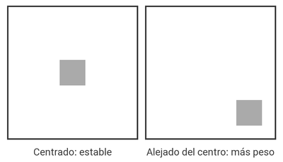 |
| **Tamaño** | A mayor tamaño, mayor peso visual. | 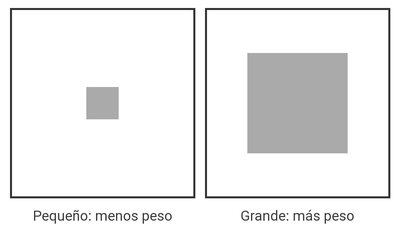 |
| **Configuración o textura** | Las formas compactas y densas pesan más que las abiertas, porosas o de contorno irregular, que dejan ver el fondo a través. | 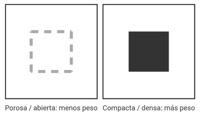 |
| **Color** | Los colores cálidos, oscuros y saturados pesan más que los fríos, claros y apagados. | 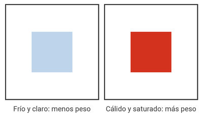 |

> El color también crea sensación de profundidad: los colores cálidos parecen **avanzar** hacia el espectador y los fríos **retroceder**. Aun así, un color frío puede avanzar si es más luminoso que los cálidos que lo rodean.

#### Tipos de equilibrio

Conociendo el peso de cada elemento, podemos repartirlo de varias formas:

- **Equilibrio formal (o axial).** Se basa en una simetría respecto a uno o varios ejes (verticales, horizontales o inclinados), explícitos o implícitos. Refleja estabilidad y calma, con una distribución armónica y predecible.
- **Equilibrio informal.** No usa simetría; se logra compensando pesos visuales distintos de manera deliberada. Algunas reglas prácticas:
  - Una forma pequeña tiene menos peso que una grande.
  - Una forma irregular resulta visualmente más pesada.
  - Los tonos vivos y brillantes pesan más que los apagados.
  - El lugar que ocupa el elemento en la composición también influye en su peso.
- **Equilibrio radial.** Los elementos parten de un punto central y se extienden hacia fuera.
- **Equilibrio de mosaico (o cristalográfico).** Nace de un desorden aparente que, visto en conjunto, conserva el equilibrio.

| Composición equilibrada | Composición desequilibrada |
| --- | --- |
| 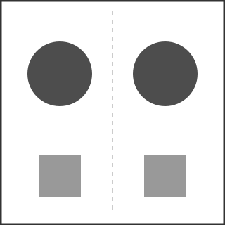 | 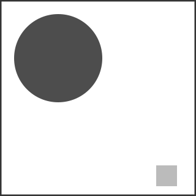 |
| El peso visual se reparte por igual a ambos lados del eje central (equilibrio formal): misma forma, tamaño y color repetidos en espejo. | El peso visual se concentra en una esquina (una forma grande y oscura) mientras el resto de la composición queda casi vacío, generando una sensación de inestabilidad. |

Los otros tres tipos de equilibrio también se pueden ilustrar con composiciones esquemáticas:

| Equilibrio informal | Equilibrio radial | Equilibrio de mosaico |
| --- | --- | --- |
| 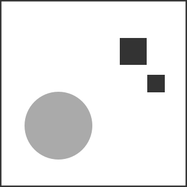 | 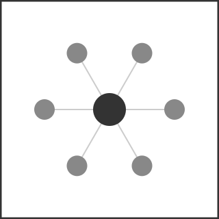 | 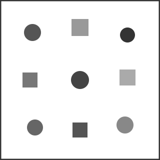 |
| Una forma grande pero de color claro (menos peso) se compensa con dos formas pequeñas y oscuras (más peso pese a su tamaño) en el lado contrario: no hay simetría, pero sí equilibrio. | Los elementos se organizan a igual distancia alrededor de un punto central, como si irradiaran desde él — el peso visual se reparte de forma uniforme en todas direcciones. | Un "caos" aparente de elementos similares en tamaño y peso, repartidos con regularidad por todo el lienzo, sin ejes ni centro reconocibles, que en conjunto se percibe equilibrado. |

**Cuatro maneras de equilibrar dos formas.** Partiendo de dos manchas en un mismo marco, se puede pasar de la simetría más rígida a composiciones más dinámicas:

| Perfecto | Por equivalencias | Por contrapeso | Cromático |
| --- | --- | --- | --- |
| 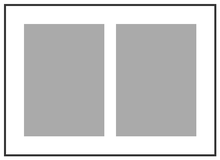 | 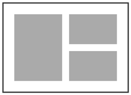 | 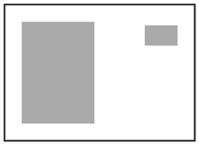 | 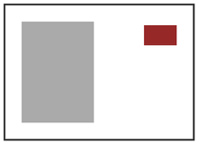 |
| Dos manchas iguales en tamaño, color y forma, a la misma distancia del centro. Equilibrio impecable, pero demasiado regular y monótono. | Se sustituye una de las figuras por otras dos menores cuyas áreas suman lo mismo. La composición gana en variedad. | El peso de la figura grande se compensa con el tamaño **y la posición** de una pequeña, alejada del centro. Composición más dinámica y activa. | Si una figura tiene un color más pesado (más oscuro o saturado), puede ser mucho más pequeña que la otra, de tono más ligero, y seguir equilibrándola. |

### 3.4 La tensión compositiva

Es la fuerza complementaria al equilibrio: en lugar de transmitir calma, busca **dirigir la mirada** y fijar la atención del usuario en un punto concreto. La tensión desorienta y pone en alerta, exige un esfuerzo extra de atención; no es buena ni mala en sí misma, es una técnica más para comunicar o crear estilo.

Las técnicas de comunicación visual se mueven siempre entre dos polos: la **armonía** (estable y equilibrada) y el **contraste** (dinámico e inestable). Algunas parejas de técnicas opuestas, según la clasificación de D. A. Dondis en *La sintaxis de la imagen*:

| Armonía | Contraste |
| --- | --- |
| Equilibrio | Inestabilidad |
| Simetría | Asimetría |
| Predecibilidad | Espontaneidad |
| Unidad | Fragmentación |
| Sencillez | Complejidad |
| Contención | Exageración |
| Redondez | Angularidad |
| Horizontalidad | Verticalidad |

El contraste es la fuerza que da vida a un mensaje: el aburrimiento es una amenaza en cualquier diseño visual, y una composición constante necesita alguna *anomalía* que llame la atención. Tres formas sencillas de generar tensión con elementos mínimos:

| Ruptura del eje | Descentramiento | Agrupamiento |
| --- | --- | --- |
| 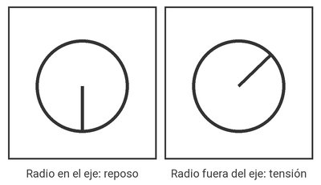 | 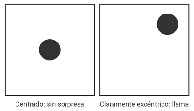 | 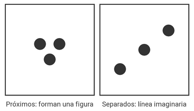 |
| Percibimos de forma natural un eje vertical con un referente horizontal. Un elemento que se aparta de ese eje —como el radio inclinado del círculo— atrae la atención mucho más que uno alineado con él. | Un punto en el centro exacto no sorprende; uno claramente excéntrico obliga al ojo a "reequilibrar" la composición. Lo que conviene evitar es el descentramiento *pequeño*, que solo parece un error. | Los elementos próximos se atraen y forman figuras (proximidad, ver [Gestalt](#35-las-leyes-de-la-gestalt)); los separados se repelen o se leen como una línea imaginaria que recorre la composición. |

Para dirigir la mirada hacia un punto concreto se usan sobre todo dos técnicas:

- **Técnica sugestiva.** Lleva la mirada hacia un punto concreto con ayuda de recursos como flechas, miradas o líneas convergentes.
- **Técnica rítmica.** Se apoya en que el ojo humano tiende de forma natural a continuar una serie de elementos que se repiten.

| Técnica sugestiva | Técnica rítmica |
| --- | --- |
| 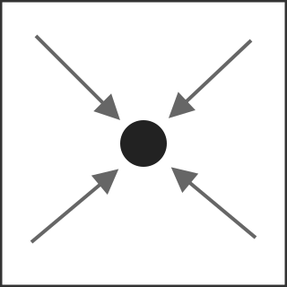 | 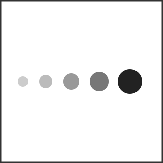 |
| Varios elementos de apoyo (líneas, flechas) apuntan hacia un mismo punto desde direcciones distintas, forzando a la vista a converger ahí. | Una secuencia de elementos que varían de forma progresiva (aquí, tamaño y tono) hace que el ojo la recorra siguiendo el patrón hasta completarla, terminando en el elemento que rompe la serie. |

La técnica sugestiva no es solo un recurso digital: es una de las herramientas de composición más antiguas de las artes visuales. Un ejemplo célebre es *La última cena* de Leonardo da Vinci, donde las líneas de fuga de la perspectiva del techo y las paredes convergen deliberadamente en la cabeza de Cristo, dirigiendo ahí la mirada del espectador.

  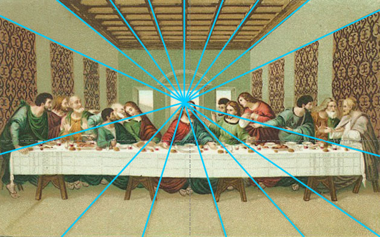

La técnica rítmica también tiene ejemplos clásicos: en *Frieze of Dancers* de Edgar Degas, una misma bailarina se repite en cuatro poses casi idénticas a lo largo del lienzo, y esa repetición es la que crea el ritmo visual que guía la mirada de un extremo a otro de la obra.

  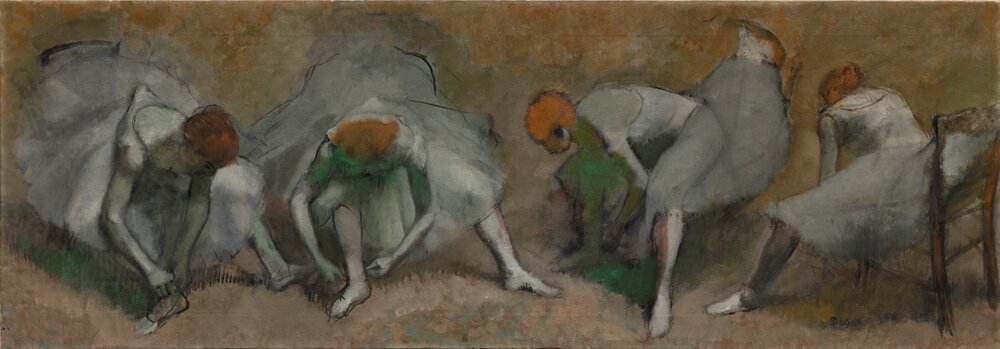

### 3.5 Las leyes de la Gestalt

La psicología de la Gestalt explica cómo el cerebro agrupa elementos visuales para darles sentido. Su idea central es que percibimos el conjunto como algo distinto de la mera suma de sus componentes.

| Ley | Descripción | Ejemplo |
| --- | --- | --- |
| **Aparición** | Percibimos las formas a medida que emergen poco a poco ante nuestra vista. | 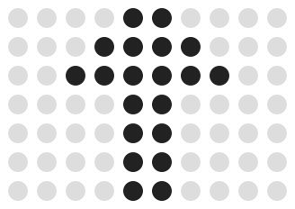 |
| **Pregnancia** | Reconocemos objetos aunque falten partes de ellos. | 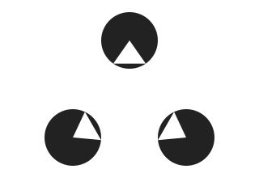 |
| **Proximidad** | Lo que está cerca se percibe como un todo. |  |
| **Semejanza** | Los elementos de aspecto parecido se ven como un grupo. | 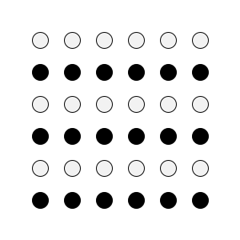 |
| **Región común** | Lo que queda dentro de un mismo recinto se interpreta como perteneciente al mismo grupo. | 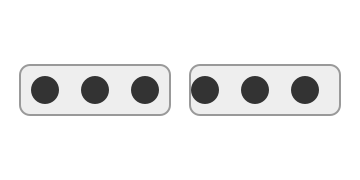 |
| **Cierre** | Varios elementos se leen como una unidad cuando componen una figura reconocible. |  |
| **Simetría** | Los elementos simétricos se perciben como grupo, aunque estén distantes. | 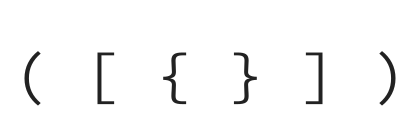 |
| **Continuidad** | La vista se deja llevar, de forma instintiva, por la orientación de los elementos. | 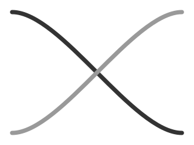 |
| **Dirección común** | Asociamos entre sí los elementos que apuntan o se mueven en la misma dirección. | 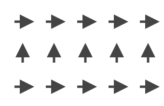 |

> Estas leyes son la base científica de muchas decisiones de diseño que veremos más adelante: por qué agrupamos opciones relacionadas en un mismo menú, por qué usamos tarjetas (*cards*) para separar contenido, o por qué alineamos elementos para sugerir que pertenecen al mismo grupo.

## 4. El color

### 4.1 El color como percepción

El color no es una cualidad física de los objetos, sino una **percepción visual**: es el cerebro quien lo construye al interpretar los impulsos que envían los fotorreceptores de la retina al captar distintas longitudes de onda de la luz. Un objeto absorbe parte de la luz que recibe y refleja el resto; ese resto es lo que percibimos como su color.

### 4.2 El modelo RGB

En pantalla, los colores resultan de mezclar tres primarios de luz: **R**ojo, **G**reen (verde) y **B**lue (azul). Es un modelo **aditivo**: al sumar los tres colores en su máxima intensidad se obtiene blanco.

  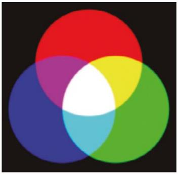

- Cada componente se codifica con 8 bits (0-255 en decimal, 00-FF en hexadecimal).
- Combinando los tres componentes se obtienen 256 × 256 × 256 = **16.777.216 colores**.

**Ejemplo — el naranja:**

| Componente | Decimal | Binario | Hexadecimal |
| --- | --- | --- | --- |
| Rojo | 255 | 11111111 | FF |
| Verde | 165 | 10100101 | A5 |
| Azul | 0 | 00000000 | 00 |

El naranja se escribe como **`#FFA500`**.

### 4.3 El modelo CMYK

Mientras que RGB es el modelo propio de las pantallas (luz), el modelo **CMYK** es el que se utiliza en imprenta y artes gráficas (tinta sobre papel). Sus siglas corresponden a **C**yan (cian), **M**agenta, **Y**ellow (amarillo) y **K**ey o *key plate* (negro).

  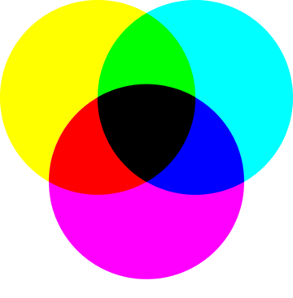

Es un modelo **sustractivo**: a diferencia de la luz, la tinta no emite color, sino que absorbe (sustrae) parte de la luz que incide sobre el papel y refleja el resto. Por eso, al superponer los tres colores primarios de tinta (cian, magenta y amarillo) en teoría se obtendría negro, ya que se estaría absorbiendo toda la luz.

En la práctica, sin embargo, las tintas reales no son perfectamente puras, por lo que esa mezcla de las tres da como resultado un negro parduzco y poco nítido. Para solucionarlo, se añade un cuarto canal de **negro puro (K)**, que además reduce el consumo de tinta de color y mejora la definición del texto.

| | **RGB** | **CMYK** |
| --- | --- | --- |
| **Uso principal** | Pantallas (web, móvil, TV) | Impresión (offset, artes gráficas) |
| **Tipo de mezcla** | Aditiva (luz) | Sustractiva (tinta) |
| **Punto de partida** | Negro (ausencia de luz) | Blanco (el papel) |
| **Máxima mezcla** | Blanco | Negro (teórico) |
| **Codificación** | 0-255 por canal | Porcentaje 0-100% por canal |

> **A tener en cuenta al diseñar:** el espacio de color de CMYK es más reducido que el de RGB (su *gamut* es menor), por lo que algunos colores vivos que se ven perfectamente en pantalla —sobre todo verdes, naranjas y azules muy saturados— no tienen una tinta equivalente exacta y se ven más apagados al imprimirse. Por eso, cualquier diseño (logotipo, tarjetería, cartelería) pensado también para imprenta debe convertirse a CMYK y revisarse visualmente antes de mandarlo a producción, en lugar de asumir que el color impreso coincidirá con el de pantalla.

**Ejemplo — el amarillo, ahora en CMYK:**

Retomando el mismo amarillo `#FFFF00` del ejemplo en RGB, así se expresaría en CMYK:

| Canal | Valor (%) |
| --- | --- |
| Cian | 0% |
| Magenta | 0% |
| Amarillo | 100% |
| Negro (K) | 0% |

Al no llevar tinta cian ni magenta, no se sustrae ni el rojo ni el verde de la luz reflejada por el papel, y el resultado percibido es el mismo amarillo puro que en pantalla — aunque, como se ha visto, esto no ocurre siempre: cuanto más saturado y "digital" es un color, más margen hay para que su equivalente impreso se perciba distinto.

**Un caso menos trivial — el verde RGB puro `#00FF00`:**

| | R | G | B |
| --- | --- | --- | --- |
| **RGB** | 0 | 255 | 0 |

| | C | M | Y | K |
| --- | --- | --- | --- | --- |
| **Conversión matemática directa** | 100% | 0% | 100% | 0% |
| **CMYK real de imprenta** (perfil estándar) | ≈62% | 0% | 100% | 0% |

Aquí ya no coincide el resultado: ni siquiera la conversión matemática "sobre el papel" es la que realmente usa una imprenta, y el verde impreso se percibe más apagado y musgoso que el verde vivo y luminoso de la pantalla. Esto ocurre por dos motivos:

- Las tintas cian y amarilla reales no son colores puros al 100%: cada una absorbe también parte de la luz que debería reflejar, así que su combinación nunca da un verde tan saturado como el de un píxel de pantalla encendido a tope.
- Ese verde está directamente **fuera del *gamut*** de CMYK: no existe ninguna combinación de tintas que lo reproduzca con exactitud, por lo que el software de impresión lo sustituye por el verde imprimible más parecido posible.

Por eso este verde es uno de los ejemplos clásicos en diseño gráfico de color que "se ve genial en pantalla, pero decepciona en el papel".

### 4.4 El modelo HSL

El modelo HSL (*Hue, Saturation, Lightness*, es decir, matiz, saturación y luminosidad) nace como una manera más natural de describir el color, próxima a cómo lo percibe el ojo humano.

  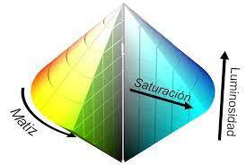

- **Matiz (Hue).** El atributo que distingue un color de otro (rojo, verde, azul...). Los matices se organizan en el círculo cromático; dos colores son **complementarios** si ocupan posiciones diametralmente opuestas en él.
- **Saturación.** La intensidad o pureza de un color, es decir, cuánto "color" tiene frente a gris. Un color muy saturado (100%) es un color puro y vivo; a medida que baja la saturación se le va mezclando gris, hasta quedar completamente deslavado o apagado. En el 0% de saturación no queda ningún matiz: solo gris.
- **Luminosidad.** La cantidad de luz que tiene un color, es decir, lo claro u oscuro que es. Es independiente de la saturación: puede haber un color muy saturado y a la vez oscuro, o poco saturado y muy claro. En un extremo (0%) cualquier color se convierte en negro; en el otro (100%), en blanco. El propio matiz solo se aprecia en los valores intermedios de luminosidad.

Para entender bien la diferencia, lo más claro es comparar un mismo matiz variando cada atributo por separado, dejando el otro fijo:

**Saturación** (matiz y luminosidad fijos, solo cambia la pureza del color):

  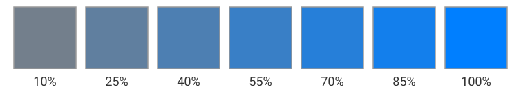

**Luminosidad** (matiz y saturación fijos, solo cambia la cantidad de luz):

  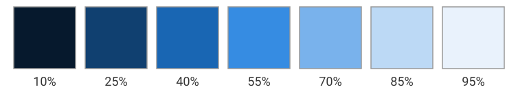

Nótese que ambas tiras parten del mismo matiz (azul) — lo único que cambia en cada una es un único atributo, precisamente para poder comparar el efecto de la saturación frente al de la luminosidad sin que el color de base interfiera.

**Escalas de color.** Variando estos atributos de forma ordenada se obtienen *escalas*, muy útiles para construir la paleta de una interfaz (fondos, bordes, estados *hover*, texto secundario...):

- **Escala acromática (de grises).** El blanco, el negro y el gris son colores **acromáticos**, es decir, sin matiz. La escala de grises es una transición continua del blanco al negro y sirve de referencia para comparar la luminosidad de cualquier color.

  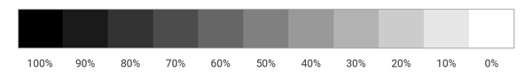

- **Escala monocroma.** Parte de un solo matiz y lo mezcla con blanco (se aclara), con negro (se oscurece) o con gris (se apaga). Es la forma más segura de conseguir una paleta armónica: todo el conjunto comparte el mismo color de base.

  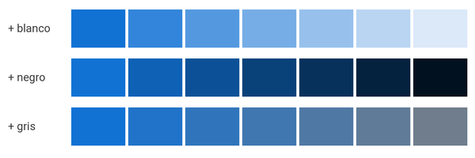

- **Escala cromática.** Combina modulaciones de valor y saturación y se clasifica en **altas** (con mucho blanco, colores pastel), **medias** (cerca del tono puro) y **bajas** (con mucho negro). Si mezcla gamas de dos o más colores se llama **polícroma**; el ejemplo más claro es el arco iris.

### 4.5 Círculo cromático y armonías del color

El **círculo cromático** (también llamado rueda de color) ordena todos los matices y sirve de guía para formar combinaciones de color armoniosas. Estas combinaciones no son cuestión solo de gusto: siguen relaciones geométricas fijas dentro de la rueda.

| Armonía | Descripción | Ejemplo |
| --- | --- | --- |
| **Complementaria** | Dos colores opuestos en la rueda. Contraste muy potente; no conviene usarlos en cantidades iguales. Ideal para resaltar un elemento sobre un fondo. | 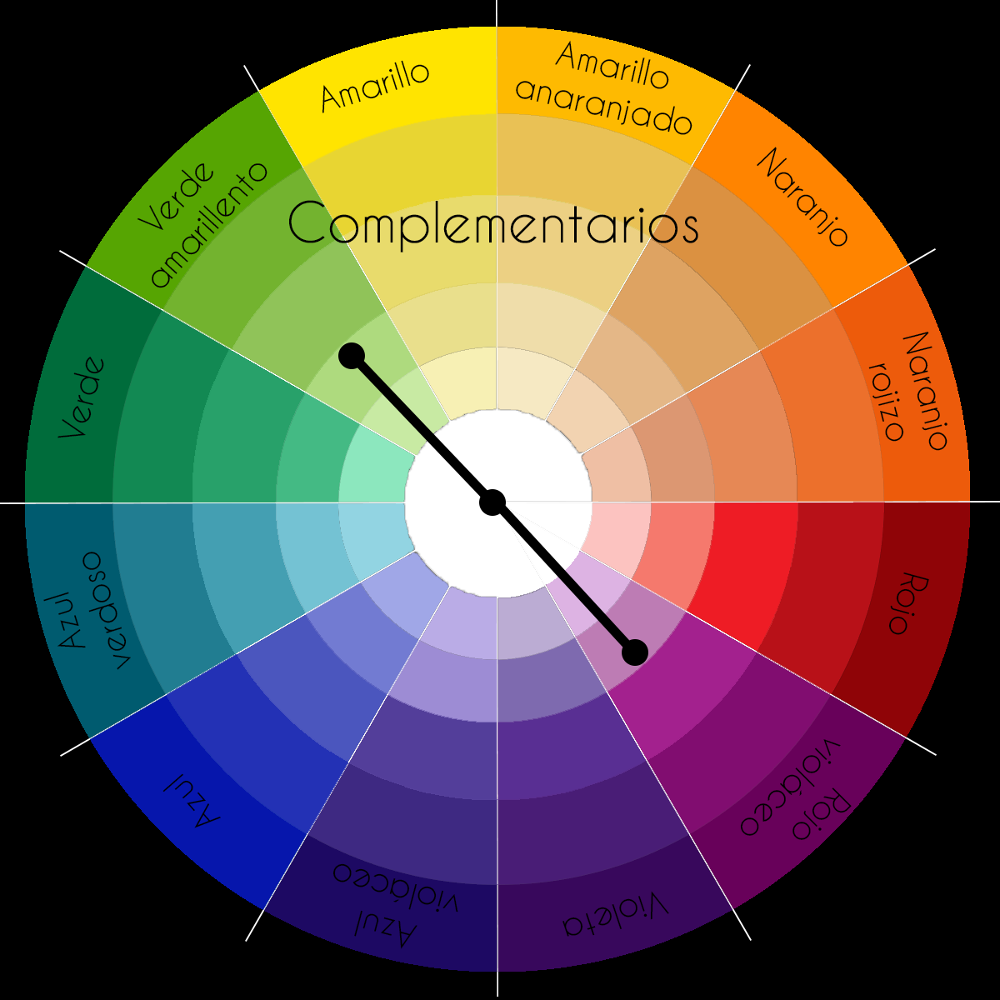 |
| **Análoga (o adyacente)** | Colores contiguos en la rueda. Combinaciones serenas y agradables, sin que ningún color domine sobre otro. | 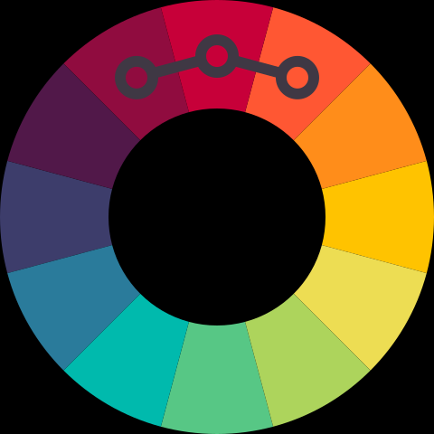 |
| **Tríada** | Tres colores equidistantes en la rueda. Se puede dejar uno como fondo y reservar los otros dos para el contenido y los detalles resaltados. | 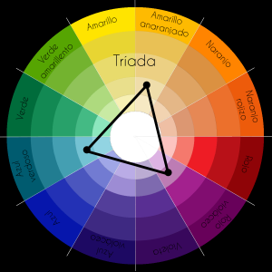 |
| **Complementaria adyacente** | Un color combinado con los dos adyacentes a su complementario. Aprovecha el resaltado del complementario junto con la homogeneidad de los análogos. | 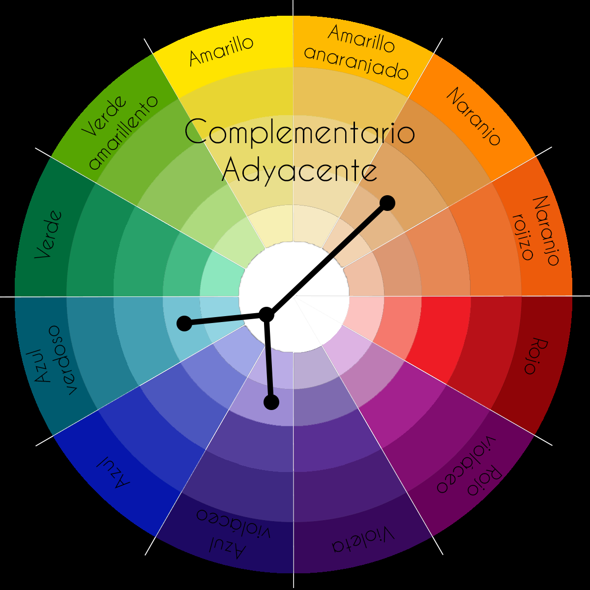 |
| **Rectangular (tetraedro)** | Dos pares de colores complementarios. Funciona bien si se establece un color dominante y se cuida el equilibrio entre cálidos y fríos. | 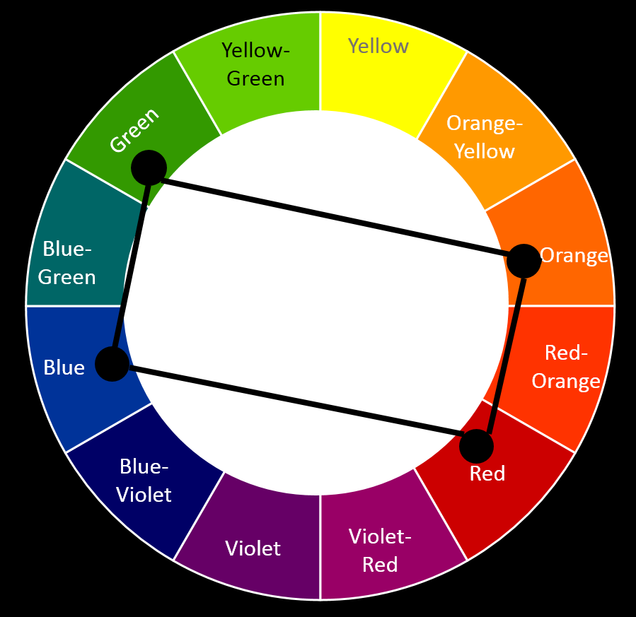 |

> Existen también los **colores cuadrados** (variante de la tríada con cuatro colores equidistantes) — ofrecen muchas combinaciones posibles, pero son más difíciles de armonizar; conviene usarlos con cuidado.

Una técnica práctica habitual: elegir primero un **color base** que dé personalidad al diseño y, a partir de él, construir el resto de la paleta con alguna de estas armonías. Herramientas como Adobe Color o Coolors generan automáticamente paletas armónicas a partir de un color de partida.

### 4.6 Psicología y significado del color

La interpretación de un color no es universal: depende en gran medida del bagaje cultural de cada persona (el color del luto es negro en Occidente, blanco en China, naranja en Egipto...). Aun así, en un contexto occidental se suelen asociar estos significados:

| Color | Significado habitual | Uso habitual en interfaces y marketing | Marcas que lo usan como color principal |
| --- | --- | --- | --- |
| Blanco | Pureza, higiene, limpieza y claridad; favorece la lectura. | Fondo por excelencia: da aire y deja protagonismo al contenido. Muy usado en salud y en productos infantiles. | Apple (en sus productos y tiendas) |
| Gris | Neutralidad, seriedad y equilibrio. | Elementos secundarios, bordes y controles **deshabilitados**. | Mercedes-Benz |
| Negro | Elegancia, lujo, prestigio, sobriedad — añade contraste y da protagonismo a los colores adyacentes. | Productos caros o exclusivos (moda, tecnología *premium*). Texto principal (mejor un gris muy oscuro que negro puro). | Chanel, Zara, Nike |
| Rojo | Pasión, energía, urgencia — acelera el pulso y abre el apetito; úsalo en dosis moderadas para llamar la atención. | **Errores**, alertas y acciones destructivas ("Eliminar"). En marketing, rebajas, ofertas por tiempo limitado y restauración. | Coca-Cola, Netflix, YouTube, Nintendo |
| Naranja | Energía, entusiasmo, diversión, cercanía — dominante y expansivo, evitar el abuso. | Botones de **llamada a la acción** ("Comprar", "Suscribirse") y **advertencias**. Transmite una marca alegre y cercana. | Fanta, Harley-Davidson |
| Amarillo | Luz, optimismo, visibilidad; ideal para resaltar, pero cansa la vista en grandes superficies. | **Advertencias** y resaltado de elementos puntuales (siempre sobre fondo oscuro o con texto oscuro: sobre blanco apenas contrasta). Capta la atención en escaparates. | McDonald's (junto al rojo), National Geographic, DHL |
| Verde | Naturaleza, salud, tranquilidad, dinero y crecimiento. | **Éxito** y confirmación ("Guardado correctamente"). Productos ecológicos, de salud o financieros. | Starbucks, Spotify, Android |
| Azul | Confianza, seguridad, calma, productividad. Es el color corporativo por excelencia. | **Enlaces** y mensajes informativos. Banca, seguros, tecnología y redes sociales, por la seguridad que transmite. Poco usado en alimentación: se dice que quita el apetito. | Facebook, LinkedIn, Samsung, Dell |
| Violeta | Nobleza, lujo, sabiduría, misterio, creatividad. | Productos de belleza y antienvejecimiento; marcas que quieren parecer creativas o imaginativas. | Yahoo!, Milka |
| Marrón | Tierra, naturaleza, sencillez, solidez y durabilidad. | Productos naturales, artesanales o agrícolas, café y chocolate. Con cuidado: en exceso resulta apagado o se asocia a suciedad. | UPS |
| Rosa | Suavidad, dulzura. | Cosmética y productos infantiles. | Barbie |

> Los colores de estado (rojo = error, amarillo/naranja = advertencia, verde = éxito, azul = información) son ya un **estándar de facto** en cualquier interfaz. Saltárselo confunde al usuario (recuerda el ejemplo de la heurística 2 de Nielsen: un mensaje de éxito en rojo), y, como veremos en [accesibilidad](#96-accesibilidad), el color nunca debe ser la única pista: conviene acompañarlo de un icono o un texto.

El color de marca no se elige al azar. Un estudio de Column Five y Marketo sobre las 100 marcas más valiosas del mundo concluyó que:

| Dato | Resultado |
| --- | --- |
| Usan **azul** en su logotipo | 33 % |
| Usan **rojo** | 29 % |
| Usan **negro o gris** | 28 % |
| Usan **amarillo o dorado** | 13 % |
| Se limitan a **uno o dos colores** | 95 % |
| Su logotipo es **solo texto** | 41 % |

La lección para diseñar interfaces es la misma: pocos colores, bien elegidos y aplicados de forma coherente en todas las pantallas.

**Colores y sectores.** El mismo estudio analiza también en qué sectores es habitual cada color de marca y en cuáles apenas se usa. No son reglas fijas, sino tendencias, pero ayudan a no elegir un color que choque con lo que el usuario espera de un tipo de producto:

| Color | Frecuente en | Poco frecuente en |
| --- | --- | --- |
| Rojo | Alimentación, tecnología, automóvil, agricultura | Energía, finanzas, aerolíneas, moda |
| Naranja | Tecnología, salud | Energía, finanzas, aerolíneas, automóvil, moda |
| Amarillo | Energía, alimentación, hogar | Finanzas, aerolíneas, tecnología, automóvil, moda |
| Verde | Energía, finanzas, alimentación, hogar, tecnología | Aerolíneas, automóvil, moda |
| Azul | Energía, finanzas, aerolíneas, tecnología, salud, agricultura | Alimentación, automóvil, moda |
| Violeta | Finanzas, tecnología, salud | Energía, agricultura |
| Marrón | Moda, automóvil, agricultura | Finanzas, aerolíneas, tecnología |
| Negro | Moda, tecnología, automóvil | Energía, finanzas, aerolíneas, salud, alimentación |
| Blanco | Moda, salud | Finanzas, alimentación |

Fíjate en que el azul, el color que encaja en más sectores, es precisamente el más usado por las grandes marcas. Y las ausencias también tienen lógica: el azul apenas aparece en alimentación, y el negro en salud.

Aparte de lo que transmiten, los colores admiten varias **clasificaciones**: cálidos o fríos, claros u oscuros, pastel o apagados, y escala de grises. Abusar de la mezcla de tonos cálidos y fríos en un mismo diseño puede desconcertar al usuario y dar impresión de descuido.

### 4.7 Contraste y accesibilidad del color

Hay contraste cuando dos colores de una composición se diferencian claramente. Es la herramienta principal para destacar un elemento sobre otro, y existen varios tipos:

| Tipo de contraste | En qué consiste | Ejemplo |
| --- | --- | --- |
| **De tono** | Un mismo color con distintos niveles de luminosidad y saturación. |  |
| **Claro / oscuro** | El caso extremo es blanco frente a negro; también cuenta la proporción de cada uno. | 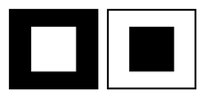 |
| **De saturación** | Un color puro frente a ese mismo color mezclado con blanco, negro o gris, o frente a un neutro. |  |
| **De cantidad** | Mucha superficie de un color frente a muy poca de otro: la pequeña mancha destaca. |  |
| **Simultáneo** | Un mismo color *parece* distinto según el fondo que lo rodea. |  |
| **De complementarios** | Colores opuestos en el círculo cromático. Para que resulte armónico, conviene que uno sea puro y el otro esté modulado con blanco o negro. |  |

> Fíjate en el contraste simultáneo: los dos cuadrados grises son **exactamente el mismo color** (`#808080`). Es un recordatorio de que el color de un botón o de un texto no se puede evaluar aislado, sino siempre sobre el fondo en el que va a aparecer.

En una interfaz, el contraste más importante es el de **luminosidad entre el texto y su fondo**, porque de él depende la legibilidad. Las **WCAG** (*Web Content Accessibility Guidelines*), que retomaremos en el apartado de [accesibilidad](#9-pautas-de-diseño-y-accesibilidad), lo miden con una **relación de contraste** que va de 1:1 (mismo color) a 21:1 (negro sobre blanco) y fijan unos mínimos:

| Nivel | Texto normal | Texto grande (≥ 24 px, o ≥ 18,7 px en negrita) |
| --- | --- | --- |
| **AA** (el exigido normalmente) | 4,5 : 1 | 3 : 1 |
| **AAA** (reforzado) | 7 : 1 | 4,5 : 1 |

  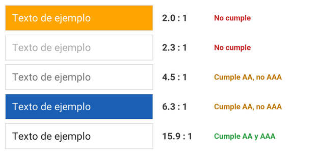

El caso del texto blanco sobre naranja es muy frecuente en botones y resulta ilegible para muchas personas, aunque "se vea bien" en el monitor de quien lo diseña. Herramientas como el *Contrast Checker* de WebAIM o el inspector de cualquier navegador calculan esta relación automáticamente.

## 5. Tipografía e iconografía

El texto es el medio más frecuente para comunicar información en una interfaz, y la forma en que se organizan las letras influye enormemente en el impacto visual del mensaje. La tipografía es a la vez **verbal y visual**: antes de leer una sola palabra, el usuario ya ha examinado los patrones gráficos generales de la pantalla.

### 5.1 Tipografía, fuente y familia tipográfica

Son tres términos que se suelen usar como sinónimos, pero no lo son:

- **Tipografía** (del griego *týpos*, 'golpe' o 'huella'): el arte y la técnica de seleccionar y disponer los tipos de letra para componer un texto.
- **Fuente**: el conjunto de caracteres (letras, números, signos) con un mismo diseño. Por ejemplo, *Roboto Bold*.
- **Familia tipográfica**: el conjunto de fuentes que comparten un mismo diseño base con variaciones de grosor (*light*, *regular*, *bold*...), anchura o inclinación. Por ejemplo, la familia *Roboto* incluye Roboto Light, Roboto Regular, Roboto Bold, Roboto Italic, etc.

**¿Qué fuente elegir?** El contenido es la clave. Antes de decidir, conviene preguntarse por:

- **La audiencia:** ¿qué edad tiene?, ¿qué contexto cultural?
- **El tono:** ¿formal?, ¿informal?, ¿cercano?, ¿técnico?
- **El propósito:** ¿informar?, ¿vender?, ¿entretener?

Y, sea cual sea la elección, el texto resultante debe ser **legible**, **comprensible** y **estético**, por este orden de prioridad.

### 5.2 Breve historia de la tipografía

Conocer de dónde vienen las familias tipográficas ayuda a entender por qué cada una transmite algo distinto:

| Época | Hito |
| --- | --- |
| Antigüedad | En Mesopotamia ya se usaban punzones para estampar signos en sellos. Las **capitales romanas** grabadas en monumentos dieron origen a los remates (serifas) que aún usamos (Trajan, Times New Roman). |
| Siglo XII | Los monjes copistas practican la **caligrafía gótica**, muy ornamentada. |
| 1440 | **Gutenberg** inventa la imprenta de tipos móviles e imita la letra de los manuscritos: nace la primera fuente, la **gótica** o *blackletter*. |
| Siglos XV-XVIII | Se imponen los estilos **romanos**, mucho más legibles que los góticos (Jenson), y después las serif **humanistas** (Caslon) y **de transición** (Baskerville). |
| 1927 | Aparece **Futura**, la sans serif geométrica más conocida. Le siguen las sans humanistas como **Gill Sans**. |
| 1957 | El **estilo suizo** busca un diseño funcional y ultralegible: nace **Helvetica**. |
| 1984-1987 | Con el Apple Macintosh llega la **tipografía digital**. En 1987 Matthew Carter crea **Charter**, uno de los primeros diseños pensados para impresoras de baja resolución. |

**Formatos de fuente digital:**

| Formato | Origen | Características |
| --- | --- | --- |
| **PostScript (Type 1)** | Adobe, años 80 | Fuentes vectoriales que se ven bien en pantalla y en impresión. Muy ligado al Macintosh. |
| **TrueType** (`.ttf`) | Apple, 1991 (adoptado enseguida por Microsoft) | Alternativa a PostScript integrada de serie en Windows y macOS, lo que la convirtió en el formato más extendido en los ordenadores personales. |
| **OpenType** (`.otf`) | Microsoft y Adobe, 1996 | Amplía los dos anteriores. Multiplataforma, hasta 65.000 glifos por fichero: alfabetos no latinos, ligaduras, caracteres alternativos... Es el estándar actual. |

> En la web se usan además **WOFF / WOFF2**, que son fuentes OpenType o TrueType comprimidas para que carguen más rápido en el navegador.

### 5.3 Anatomía y clasificación

Para hablar de tipografía con precisión conviene conocer las partes de una letra:

  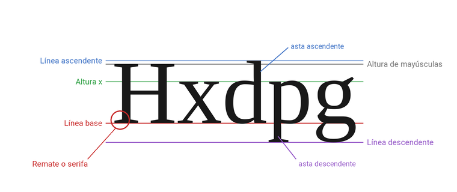

- **Línea base:** sobre la que se apoyan las letras.
- **Altura x:** la altura de las minúsculas sin ascendentes ni descendentes (como la *x*). Una altura x generosa mejora la legibilidad en pantalla con tamaños pequeños.
- **Ascendentes y descendentes:** los trazos que sobresalen por encima (b, d, h, l) o por debajo (g, p, q) de la altura x.
- **Remate o serifa:** el pequeño trazo que remata los extremos de las letras en las fuentes *serif*.

Según tengan o no remates y cómo sean sus trazos, las fuentes se clasifican así:

  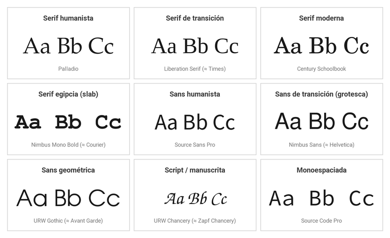

| Categoría | Rasgos | Ejemplos | Uso recomendado |
| --- | --- | --- | --- |
| **Serif humanista** | Inspirada en la caligrafía, poco contraste entre trazos gruesos y finos. | Garamond, Palatino | Clásica y tradicional: periodismo, historia. |
| **Serif de transición** | Más contraste y remates más afilados. | Times New Roman, Baskerville | Seria y sólida: ámbito académico o legal. |
| **Serif moderna (didona)** | Contraste muy acusado, remates finos y horizontales. | Bodoni, Didot | Elegante: moda, arte, cultura (Vogue). |
| **Serif egipcia (*slab*)** | Remates gruesos y rectangulares, poco contraste. | Rockwell, Courier | Con autoridad pero cercana: promoción, marketing. |
| **Sans humanista** | Sin remates, pero con curvas de origen caligráfico. | Gill Sans, Open Sans | Cercana: administración pública, educación. |
| **Sans de transición (grotesca)** | Trazos uniformes y verticales. | Helvetica, Arial, Roboto | Neutra y moderna: tecnología. |
| **Sans geométrica** | Construida sobre círculos, cuadrados y triángulos. | Futura, Avant Garde, Montserrat | Rigurosa: ciencia, arquitectura. |
| **Script** | Imita la escritura a mano o la caligrafía. | Zapf Chancery, Pacifico | Solo títulos o detalles decorativos, nunca para el cuerpo del texto. |
| **Monoespaciada** | Todos los caracteres ocupan exactamente el mismo ancho. | Courier, Consolas, Source Code Pro | Código fuente, terminales, datos tabulados. |

> Las muestras de la imagen están compuestas con fuentes libres equivalentes a las clásicas (Palladio en lugar de Palatino, Nimbus Sans en lugar de Helvetica...), que es lo que haríamos también en un proyecto real si no tenemos licencia de la original.

Una advertencia clásica: *Comic Sans* es una fuente de tipo *script* que nunca debería usarse para el cuerpo del texto de una interfaz profesional; su tono informal choca con casi cualquier contenido serio.

### 5.4 Combinar fuentes

Usar una serif para los títulos y una sans serif para el cuerpo (o al revés) es la forma más sencilla de combinar fuentes. La regla de oro es: **"mantenlo exactamente igual o cámbialo mucho"**. Dos fuentes demasiado parecidas no contrastan lo suficiente, pero tampoco son iguales, y el resultado parece un descuido.

  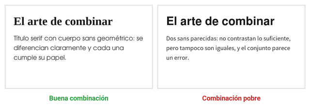

- **No combinar dos fuentes de la misma clasificación** (dos sans grotescas, dos serif de transición...).
- Funcionan bien las parejas que comparten un **rasgo común** siendo de distinto tipo: por ejemplo, una sans humanista y una serif humanista (Gill Sans y Joanna, ambas de Eric Gill).
- El mayor contraste posible —y que suele funcionar— es una **script con una sans geométrica**.
- **No es obligatorio combinar.** Una sola familia usando distintos pesos (*light*, *regular*, *bold*) es un punto de partida perfecto.
- Conviene **no mezclar más de dos o tres fuentes** en toda la aplicación, y usarlas de forma uniforme en todas las pantallas.

### 5.5 Tamaño, interlineado y longitud de línea

**Jerarquía visual.** El ojo se mueve de los elementos grandes a los pequeños, así que el tamaño ayuda al usuario a procesar el contenido. Una forma sencilla de construir la jerarquía es partir del tamaño del cuerpo de texto y escalar el resto a partir de él:

  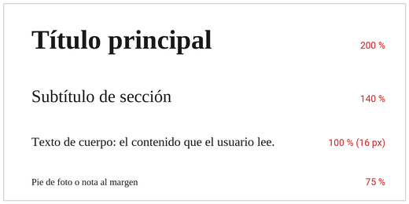

- **Cuerpo de texto:** no hay un estándar absoluto, pero en pantalla se recomiendan **16 px como mínimo** (entre 16 y 20 px es lo habitual; hasta 26 px en textos de lectura larga).
- **Negrita y cursiva:** sirven para dar énfasis y crear jerarquía, pero con moderación: si todo está en negrita, nada destaca.

**Interlineado** (*leading*, `line-height` en CSS). Es el espacio entre líneas. Si es demasiado pequeño el texto resulta agobiante; si es demasiado grande, las líneas se perciben desconectadas. Un buen interlineado ronda el **120-150 %** del tamaño de la fuente; `line-height: 1.5` es un valor seguro para el cuerpo de texto.

  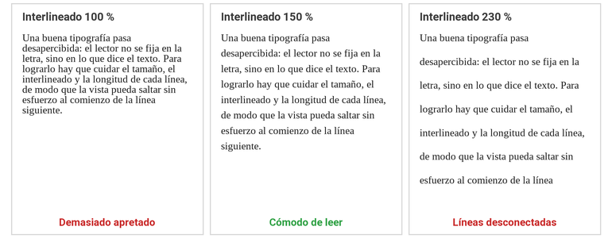

**Longitud de línea.** Se mide en caracteres por línea (CPL). Las líneas muy largas cansan porque cuesta encontrar el comienzo de la siguiente; las muy cortas rompen el ritmo de lectura. Lo recomendable es entre **45 y 75 caracteres** por línea (unos 60 es ideal), algo menos en móvil. En la práctica se controla limitando el ancho máximo del bloque de texto (`max-width`) aunque la ventana sea mucho más ancha.

  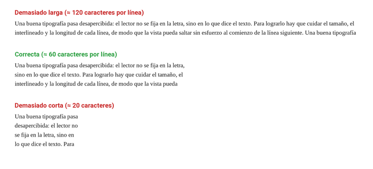

**Viudas y huérfanas.** Son líneas sueltas que quedan separadas de su párrafo: la **huérfana** es la primera línea de un párrafo que queda sola al final de una columna o página, y la **viuda** es la última línea que queda sola al comienzo de la siguiente. Rompen la continuidad de la lectura y dan sensación de descuido; en diseño web se usa el mismo término para una palabra que queda sola en la última línea de un párrafo.

  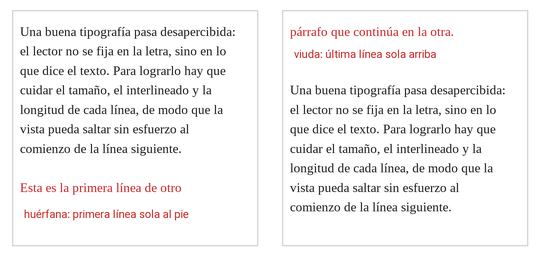

### 5.6 Buenas prácticas y recursos

- **Legibilidad ante todo.** El tamaño y el tipo de letra deben adaptarse al dispositivo y al contexto de uso.
- **Serif o sans serif.** Con las pantallas de alta resolución actuales ambas se leen bien, pero las sans serif siguen siendo la opción más habitual en interfaces, sobre todo en tamaños pequeños; las serif funcionan muy bien en textos largos e impresos.
- **Fuentes seguras (*safe fonts*).** Fuentes presentes en todos los sistemas, que evitan que el texto se muestre con una tipografía distinta a la prevista. Hoy es más habitual **incrustar la fuente** con la aplicación o servirla como *web font*, indicando siempre fuentes alternativas por si falla la carga.
- **Licencias.** No todas las fuentes gratuitas se pueden usar en un producto comercial: revisa siempre la licencia (Google Fonts, por ejemplo, usa la licencia libre SIL Open Font License).
- **Dónde conseguir tipografías:** Google Fonts, Font Squirrel, Adobe Fonts o Dafont (en esta última, con cuidado con las licencias).
- **Herramientas para combinar fuentes:** Fontjoy, *Canva Font Combinations*.
- **Herramientas para crear tu propia fuente:** FontForge (libre), FontStruct o Calligraphr.

### 5.7 Iconografía

Los iconos son imágenes gráficas que actúan como metáfora visual de una acción o de un contenido, y su uso reduce la cantidad de texto necesario en una interfaz. Buenas prácticas:

- Han de **representar con claridad** la acción a la que se asocian, de forma que el usuario los reconozca al instante.
- Cuanto más **simple** el diseño, mejor: solo los detalles imprescindibles para comprender su significado.
- Un icono nunca es totalmente inequívoco: está sujeto a interpretación subjetiva. **No conviene usarlos en solitario para operaciones críticas** — es preferible combinarlos con un texto.
- **Recursos para adquirir iconos:** Flaticon, Font Awesome, Dafont.

## 6. Componentes de una interfaz

Con el tiempo, el diseño de interfaces (especialmente el web) ha evolucionado hacia la homogeneidad: la mayoría de aplicaciones comparten una serie de bloques estructurales comunes, aunque ninguno sea estrictamente obligatorio.

  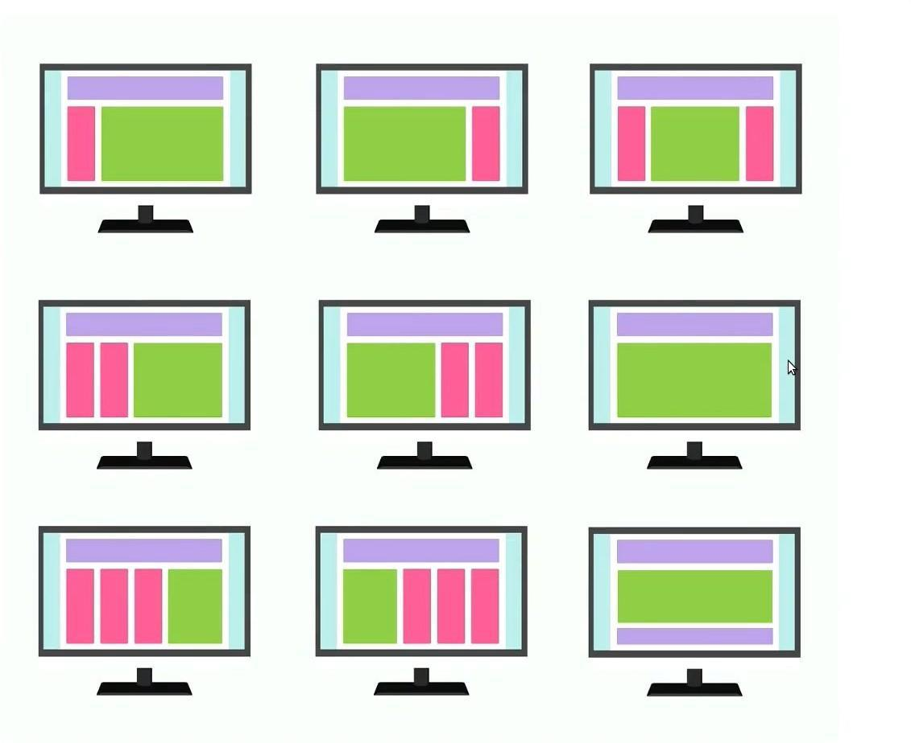

### 6.1 La cabecera

Situada arriba del todo, cumple varias funciones: identificar la aplicación o sitio con su logotipo y nombre, homogeneizar todas las pantallas (suele ser un elemento común a todas ellas) y marcar una división nítida entre el borde de arriba y el contenido.

  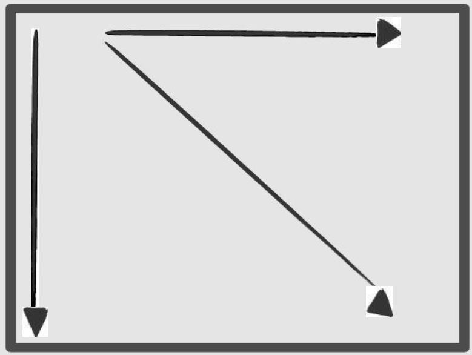
  

La mirada del usuario arranca en el ángulo superior izquierdo de la pantalla y desde allí recorre el resto, de ahí que el logotipo suela ir justo en ese punto.

### 6.2 Sistemas de navegación

Permiten al usuario moverse por las distintas secciones de la aplicación. Suelen presentarse como menús, y hay que distinguir dos aspectos independientes: el **tipo** de navegación (cómo organiza las opciones) y su **orientación** (cómo se coloca en la pantalla) — cualquier tipo puede combinarse con cualquier orientación.

**Tipos de navegación:**

| Tipo | Descripción | Ejemplo |
| --- | --- | --- |
| **Árbol** | Al seleccionar una opción se despliegan sus subopciones, jerarquizando el contenido. |  |
| **Pestañas** | Cada pestaña representa una sección; el contenido cambia sin abandonar la pantalla. |  |
| **"Estás aquí" (migas de pan / *breadcrumbs*)** | Encadena, como una ruta de enlaces (p. ej. `Inicio › Electrónica › Portátiles`), todos los niveles por los que ha pasado el usuario hasta llegar a la pantalla actual. Cada nivel es un enlace: al pulsarlo, se vuelve directamente a esa pantalla, sin tener que retroceder paso a paso. El nombre viene del cuento de Hansel y Gretel: igual que ellos iban dejando migas de pan para poder encontrar el camino de vuelta, esta ruta va dejando un "rastro" de cada paso dado. |  Electrónica > Portátiles', los tres niveles subrayados como hipervínculos" width="150"> |

Cuando un menú acumula demasiadas entradas (más de 5), es mejor organizarlas en niveles mediante menús dobles o desplegables en árbol.

**Orientación:**

Con independencia del tipo elegido, la navegación puede organizarse en **horizontal** (perfecta cuando hay pocas secciones) o en **vertical** (ideal para muchas páginas anidadas); ambos esquemas funcionan bien con menús desplegables.

  
  

### 6.3 El cuerpo

Aquí se muestra la información principal, con una extensión que va del 50 % al 80-85 % del espacio disponible. Suele destacar su título con un tamaño de letra mayor o un color distinto.

  
  

La zona de contenido principal puede ir debajo de una navegación horizontal o a la derecha de una vertical. Además, **la mirada se deja guiar por las indicaciones de dirección** presentes en la página (flechas, líneas, miradas de personas), por lo que deben orientarse siempre hacia lo que interesa destacar:

  

El contenido secundario debe ser más pequeño y quedar relegado al lateral, o bien dividirse en porciones y colocarse bajo el contenido principal:

  
  

### 6.4 El pie de página

Se coloca debajo del contenido principal y ofrece datos breves y complementarios: enlaces a servicios particulares (contacto, condiciones de uso, contratación de publicidad), información de la empresa, o un menú auxiliar reducido.

  

### 6.5 Los espacios en blanco

Son las zonas sin elementos gráficos. Aunque parezcan "espacio desperdiciado", cumplen una función esencial: equilibran el peso visual de los demás elementos, generan márgenes y separaciones y delimitan la composición; así la interfaz gana equilibrio, orden y legibilidad. (Y no siempre son literalmente blancos: lo importante es que estén *vacíos* de contenido).

### 6.6 Proporción áurea, regla de los tercios y *grid system*

- **Proporción áurea (φ ≈ 1,618).** Situar los elementos principales siguiendo esta proporción aporta a la composición de sensación de profundidad y equilibrio, guiando la mirada hacia el punto de mayor interés.
- **Regla de los tercios.** Una aproximación simple a la proporción áurea: se divide la composición en una cuadrícula de tercios, y los 4 puntos donde se cruzan las líneas son las posiciones ideales para lo más importante, porque el ojo acude antes a ellos. Al leer una pantalla, la mirada suele recorrer un patrón parecido a una "F", en el que la esquina superior izquierda es el área que más peso tiene.
- ***Grid system*.** Una retícula de guías horizontales y verticales que forma columnas (separadas por "canales" o *gutters*) para repartir los elementos con proporción. En una cuadrícula fija el diseño mantiene su tamaño; en una fluida, se ajusta a la ventana.

| Proporción áurea | Regla de los tercios | *Grid system* |
| --- | --- | --- |
|  |  |  |
| Cada cuadrado de la espiral es 1,618 veces menor que el anterior; situar los elementos siguiendo esta curva aporta profundidad y dirige la mirada hacia el centro de interés. | Los elementos importantes (aquí, resaltado con un círculo) se colocan sobre alguno de los 4 puntos donde se cruzan las líneas, ya que es donde primero se posa la vista. | Los bloques de contenido se alinean siempre al ancho de una o varias columnas, nunca a medias, manteniendo la proporción y el orden del conjunto. |
|  |  |  |
| La naturaleza también sigue esta proporción: contando las espirales de semillas de un girasol se obtienen 89 en un sentido y 144 en el otro — dos números consecutivos de Fibonacci, cuya razón (144/89 ≈ 1,618) es prácticamente φ. | La torre del faro cae sobre la línea vertical derecha, el farol coincide con esa intersección y el horizonte con la línea inferior: tres puntos de interés alineados con la retícula, no al azar. | Piet Mondrian construía sus cuadros como una retícula de líneas que organiza el lienzo en bloques de color, el mismo principio que un *grid system* aplica a una interfaz. |

**Rectángulos con y sin proporción áurea:**

| Con proporción áurea | Sin proporción áurea |
| --- | --- |
|  |  |
| Los cuatro rectángulos comparten la misma proporción ancho/alto (φ ≈ 1,618:1), y cada uno es φ veces más pequeño que el anterior: la serie transmite orden y una progresión reconocible. | Cada rectángulo tiene una proporción distinta y el tamaño no sigue ninguna relación fija con el anterior: el conjunto resulta irregular, sin un criterio que lo explique. |

> Todas estas reglas de composición (equilibrio, proporción áurea, tercios, *grid system*...) no son un límite rígido, sino una base que conviene dominar antes de saltársela. Un diseñador que las conoce bien puede romperlas de forma deliberada para conseguir un efecto concreto —como la tensión compositiva del punto [3.4](#34-la-tensión-compositiva), que rompe el equilibrio para dirigir la mirada—, mientras que quien no las domina simplemente produce una composición desordenada sin querer.

## 7. Prototipado y herramientas

### 7.1 Tipos de prototipo

Antes de construir la interfaz definitiva, se elabora un **prototipo**: una maqueta que permite hacerse una idea del resultado final, comprobar funcionalidades o realizar pruebas de usabilidad, ahorrando tiempo, esfuerzo y dinero. Existen distintos niveles de definición:

| Tipo | Nivel de detalle | Descripción | Ejemplo |
| --- | --- | --- | --- |
| **Sketch** | Muy bajo | Boceto esquemático, normalmente en papel, sin entrar en detalles de diseño. Es la fase inicial. |  |
| **Wireframe** | Bajo-medio | Dibuja las pantallas con un nivel de detalle moderado: bocetos del contenido y de los botones de acción. Se puede hacer en papel o con software. Lo que cuenta es cómo se organiza el contenido, no el aspecto. |  |
| **Mockup** | Alto | Un wireframe al que se añaden ya valores de presentación definitivos: color, tipografía, *look & feel* de cada componente. |  |
| **Prototipo** | Alto (e interactivo) | Serie de pantallas enlazadas con interacción real, cuyo acabado se parece al del mockup. Es la fase final, la que se usa para pruebas de usuario. |  |

Las cuatro imágenes representan la misma pantalla (una lista de productos) en cada nivel de fidelidad, para apreciar cómo evoluciona: del boceto a mano alzada, pasando por la estructura sin estilo y el acabado visual definitivo, hasta llegar a un conjunto de pantallas realmente conectadas entre sí.

**¿Se respetan los tamaños y las distancias?** No en todos los tipos: la precisión crece con la fidelidad.

| Tipo | Tamaños y distancias |
| --- | --- |
| **Sketch** | No se respetan: es un dibujo rápido y desechable. Solo se cuida la **jerarquía relativa** (lo importante, más grande y más arriba) y que cada elemento esté en su zona aproximada. |
| **Wireframe** | **Se respetan las proporciones y la distribución, pero no los píxeles exactos.** En papel, el tamaño es aproximado. En una herramienta como Figma se dibuja ya sobre un *frame* del tamaño real de la pantalla o de la ventana, y se fijan la rejilla de filas y columnas y la zona que ocupa cada bloque; los tamaños de los controles y los márgenes siguen siendo aproximados. |
| **Mockup** | **Se respetan con medidas exactas:** espaciado, altura de los controles, tamaño de la tipografía y de los iconos, márgenes y separación entre grupos. Es el que se mide para programar la interfaz. |
| **Prototipo** | Las mismas medidas que el mockup, del que parte. |

Por eso conviene hacer el wireframe digital ya con el tamaño real: al pasar al mockup solo hay que sustituir las cajas grises por los componentes definitivos, sin redistribuir la pantalla.

**Símbolos de los sketches y wireframes.** Como en estas fases no importa el aspecto, cada elemento de la interfaz se representa con un símbolo sencillo, rápido de dibujar a mano y que cualquier diseñador o programador reconoce:

  

| Símbolo | Significado |
| --- | --- |
| Rectángulo con las **dos diagonales** (un aspa) | **Imagen** o foto. El aspa indica "aquí va una imagen" sin dibujarla. |
| Aspa con un **triángulo de reproducir** en el centro | **Vídeo**. |
| **Círculo** con una silueta (o con aspa) | **Avatar** o foto de perfil. |
| Cuadrado **pequeño** con aspa | **Icono**. Si ya se sabe cuál, se dibuja simplificado (una lupa, una papelera). |
| Barra **gruesa** y varias **líneas** finas (rectas u onduladas) | **Título y texto**. Las líneas simulan el texto, que todavía no está escrito. |
| Rectángulo (con las esquinas redondeadas) y una **palabra dentro** | **Botón**. Se escribe la acción real ("Aceptar", "Guardar"). |
| Rectángulo **vacío** con una etiqueta encima y, a veces, un cursor | **Campo de texto** (`TextBox` en WPF). |
| Campo con una **lupa** | **Búsqueda**. |
| Campo con un **triángulo hacia abajo** | **Lista desplegable** (`ComboBox`). Se dibuja abierta si importa ver las opciones. |
| **Cuadrado** con ✓ / **círculo** con un punto | **Casilla de verificación** (`CheckBox`) / **botón de opción** (`RadioButton`). |
| Línea con un **círculo** encima | **Deslizador** (`Slider`). |
| Rectángulos unidos sobre un recuadro, uno de ellos destacado | **Pestañas** (`TabControl`). |
| Recuadro con una barra superior y **– □ ×** | **Ventana** o **cuadro de diálogo**. |
| Barra con palabras ("Archivo Editar Ver") | **Barra de menús**, con un menú desplegado si interesa mostrarlo. |
| **Tres líneas** horizontales | **Menú** oculto (menú hamburguesa). |
| **Rejilla** con la primera fila sombreada | **Tabla de datos** (`DataGrid`). La fila sombreada es la cabecera. |
| Recuadro con líneas y una **barra estrecha** en un lateral | **Lista** o zona con **desplazamiento**. |
| Ejes con barras o una línea | **Gráfico**. |
| Recuadro con un **marcador** de posición | **Mapa**. |
| **Número en un círculo** (en otro color) y una nota al margen | **Anotación**: explica un comportamiento que el dibujo no muestra ("al pulsar, abre la ficha"). |

Si un elemento no tiene símbolo propio, se dibuja un rectángulo y se escribe dentro qué es. Lo importante es que el boceto se entienda, no que sea bonito.

**Antes de las pantallas: el *user flow*.** Para saber qué pantallas hay que prototipar y cómo se enlazan entre sí, antes de dibujar el primer boceto se elabora un ***user flow*** (flujo de usuario): un diagrama que representa el recorrido que hace el usuario para completar una tarea en la aplicación, con los pasos que da, las decisiones que se encuentra y lo que hace el sistema en cada momento. Se dibuja como un diagrama de flujo con unas pocas formas, cada una con un significado:

| Forma | Significado |
| --- | --- |
| Óvalo | **Comienzo y cierre** del flujo. |
| Rombo | **Decisión**: el flujo se divide según la respuesta (sí / no). |
| Paralelogramo | **Interacción del usuario**: introduce datos, elige una opción, pulsa un botón. |
| Rectángulo | **Proceso** que realiza el sistema. |
| Flecha | **Dirección** en la que avanza el flujo. |

Siguiendo con el ejemplo de la lista de productos, este sería el *user flow* de la tarea "buscar un producto y ver su ficha":

  

El *user flow* es también la lista de pantallas del proyecto: cada paso que el usuario ve (la búsqueda, la lista de resultados, el aviso de "sin resultados", la ficha) tendrá que dibujarse luego en el wireframe. Además, ayuda a detectar a tiempo los caminos alternativos que suelen olvidarse, como qué ocurre cuando una búsqueda no encuentra nada. Herramientas como **FigJam** (ver el apartado [7.3](#73-herramientas-de-desarrollo-de-interfaces)) incluyen plantillas específicas para dibujarlos.

### 7.2 El proceso de diseño iterativo

  

Un buen proceso de diseño no termina en el primer prototipo, sino que se retroalimenta:

1. Medir cuán satisfecho queda el usuario tras probar la aplicación (o el prototipo).
2. Evaluar, con los datos recogidos, aspectos como el tiempo empleado en aprender el manejo de la aplicación, el uso de la ayuda, o si se cumplen los requisitos planteados al inicio.
3. Si los resultados no alcanzan lo esperado: replantear el diseño, subsanar los fallos encontrados y repetir desde el primer paso.

Trabajar con prototipos acelera el desarrollo (cambiar un prototipo cuesta menos que rehacer un diseño terminado) y mantiene al cliente implicado, pues es él quien da el visto bueno en cada iteración.

### 7.3 Herramientas de desarrollo de interfaces

| Herramienta | Licencia | Lenguajes soportados |
| --- | --- | --- |
| **Visual Studio** | Propietaria (*Community*: libre) | C#, HTML, JavaScript, XML |
| **MonoDevelop** | Libre | C#, Java, .NET, Python |
| **Glade** | Libre | C++, C#, Java, Python |
| **NetBeans** | Libre | Java, HTML, PHP, Python |
| **Eclipse** | Libre | Java, C++, PHP |

Para la fase de prototipado específicamente, son muy usadas herramientas como **Balsamiq**, **Pencil** o **Figma**, entre otras.

Figma incluye además **FigJam**, una pizarra digital colaborativa pensada para las fases previas al diseño visual: sesiones de *brainstorming* con notas adhesivas, mapas de usuario, análisis de la competencia y diagramas de flujo como el ***user flow***. Ofrece plantillas ya preparadas (por ejemplo, *Flow chart*) y, al estar integrada en Figma, permite pasar de la investigación y los diagramas al wireframe sin cambiar de herramienta.

### 7.4 Guías de estilo y sistemas de diseño

A medida que un proyecto crece (o cuando varias personas trabajan en él a la vez), conviene formalizar las decisiones de diseño en documentos reutilizables:

- **Guía de estilos.** Documento que recoge los criterios y estándares de calidad que ha de cumplir una interfaz: colores, tipografía, iconos, estructura, mapa de navegación. Garantiza la coherencia y homogeneidad del conjunto.
- **Librería de componentes.** Un catálogo de piezas de interfaz reutilizables, normalmente construido siguiendo la filosofía del **diseño atómico** (átomos → moléculas → organismos → plantillas → páginas).
- **Sistema de diseño.** Reúne lo anterior y añade indicaciones sobre en qué momento y de qué modo emplear cada elemento (cuándo usar un botón u otro, qué márgenes aplicar según la plataforma, etc.). Ejemplos conocidos: los sistemas de diseño de Airbnb, Uber o Shopify.

## 8. Usabilidad

### 8.1 Definición y parámetros de la usabilidad

Para que una aplicación tenga éxito, debe ofrecer acceso rápido a sus contenidos y una experiencia visual agradable. La **usabilidad** (*usability*) es la facilidad con la que los usuarios utilizan una aplicación: la eficiencia de la navegación y la rapidez con la que entienden su funcionamiento. Tiene que ver con cómo la interfaz presenta la información y con cómo el usuario la utiliza, atendiendo a parámetros como la sencillez y la claridad.

No hay que confundirla con la **experiencia de usuario** (UX, ver el apartado [2.1](#21-ux-vs-ui-dos-perfiles-un-mismo-objetivo)): la usabilidad mide si la aplicación es *fácil de usar*, mientras que la UX abarca todo lo que el usuario *siente* al usarla. La usabilidad es una parte, imprescindible, de una buena experiencia de usuario.

Una buena usabilidad no es un lujo: en un mercado donde la competencia está a un clic de distancia, el usuario que no encuentra lo que busca en unos pocos segundos abandona la aplicación. En una web, eso se traduce en menos tiempo de permanencia, más usuarios que se van sin interactuar y, en definitiva, menos clientes.

Un **test de usabilidad** mide lo sencilla que resulta una aplicación mediante tres parámetros:

| Parámetro | Qué mide | Ejemplos de métricas |
| --- | --- | --- |
| **Satisfacción** | Lo contento que queda el usuario, según su propia opinión | Nota de satisfacción, frecuencia de uso, sensación de facilidad de aprendizaje |
| **Efectividad** | Hasta qué punto se logra el objetivo, relacionado con lo fácil que es aprender | Tareas importantes terminadas, consultas a la documentación o ayuda, funciones aprendidas, errores admitidos |
| **Eficiencia** | Lo que se tarda en terminar una tarea | Tiempo útil de uso, tiempo de aprendizaje, rendimiento al primer intento, errores que se repiten |

### 8.2 Los usuarios: diversidad de capacidades

Una interfaz debe dar respuesta a la diversidad de quienes la van a usar:

- **Capacidades cognitivas y perceptivas.** Cómo entiende el usuario el lenguaje y con qué rapidez aprende y asimila lo nuevo.
- **Culturales.** El idioma o el bagaje cultural del usuario pueden influir en cómo interpreta formatos, unidades de medida o signos de puntuación.
- **Discapacidades.** La interfaz debe resultar utilizable por personas con cualquier tipo de discapacidad (se trata con más detalle en el apartado de [accesibilidad](#9-pautas-de-diseño-y-accesibilidad)).
- **Tecnológicas.** Calidad de la conexión, dimensiones de la pantalla, memoria disponible, etc.

### 8.3 Las 10 heurísticas de usabilidad de Nielsen

Jakob Nielsen formuló en los años 90 diez principios heurísticos que siguen siendo el estándar de referencia para evaluar la usabilidad de cualquier interfaz. No dejan de ser, en el fondo, una evolución de los principios de Hansen que vimos en el apartado de [IPO](#1-interacción-persona-ordenador-ipo).

| # | Heurística | En qué consiste | Ejemplo |
| --- | --- | --- | --- |
| 1 | **Visibilidad del estado del sistema** | El sistema ha de tener al usuario al corriente de lo que sucede, respondiendo de forma adecuada y sin demoras excesivas. | Un formulario debe indicar claramente si el envío se ha realizado correctamente o ha fallado, no dejar al usuario sin respuesta. |
| 2 | **Correspondencia con el mundo real** | Usar el lenguaje del usuario: palabras y conceptos familiares, no terminología técnica. | Evitar un aviso de operación correcta en rojo: fuera de la pantalla, ese color se asocia a la prohibición. |
| 3 | **Control y libertad del usuario** | Dar una "salida de emergencia" evidente para revertir acciones indeseadas sin trámites largos. | Poder cancelar el envío de un correo en Gmail justo después de pulsar "Enviar". |
| 4 | **Consistencia y estándares** | Un mismo elemento debe actuar igual en toda la aplicación y respetar los usos habituales de la plataforma. | Si el botón "Guardar" es azul en una pantalla, debe serlo en todas. |
| 5 | **Prevención de errores** | Es preferible diseñar para que el fallo no llegue a producirse que avisar cuando ya ha ocurrido. | Validar el formato de un email mientras el usuario lo escribe, en lugar de solo al enviar el formulario. |
| 6 | **Reconocimiento antes que memorización** | Aliviar la memoria del usuario dejando visibles los objetos, las acciones y las opciones. | Autocompletar en un buscador en lugar de obligar a recordar el nombre exacto de un producto. |
| 7 | **Flexibilidad y eficiencia de uso** | Proporcionar atajos a los expertos sin perjudicar a quien empieza. | Incluir `Ctrl+B` para negrita, además del botón correspondiente en el menú. |
| 8 | **Diseño estético y minimalista** | No incluir en cada pantalla datos irrelevantes o prescindibles. | En la pantalla inicial de una app bancaria, ofrecer únicamente "Saldo", "Transferir" y "Movimientos", sin recargarla. |
| 9 | **Ayudar a reconocer, diagnosticar y recuperarse de errores** | Los avisos de error han de estar en un lenguaje simple, precisar cuál es el fallo y proponer una solución. | En lugar de "Error 404", mostrar "La página no se ha encontrado. Comprueba la URL o vuelve atrás". |
| 10 | **Ayuda y documentación** | Aunque lo mejor es no depender de ella, ha de estar a mano, poder buscarse con facilidad y girar en torno a las tareas del usuario. | Un botón de ayuda contextual (*tooltip*) que explique una opción compleja justo donde se necesita. |

  

### 8.4 Claves de la usabilidad en la práctica

Las heurísticas son principios generales. Llevadas al día a día del diseño de una aplicación (especialmente web), se traducen en cuatro factores clave:

- **Univocidad.** En pocos segundos el usuario debe poder responder a la pregunta *"¿de qué va esto?"*. La pantalla de inicio es el punto de referencia para la mayoría de usuarios: un eslogan breve bajo el logotipo o una presentación clara de lo que ofrece la aplicación bastan para conseguirlo.
- **Orientación y estructura.** Todos los botones, iconos y elementos de navegación deben entenderse sin necesidad de explicarlos, y el usuario debe saber siempre qué pasará al pulsar algo. Ayudan mucho los símbolos ya asentados (el carrito de la compra, la lupa del buscador) y los [estándares de facto](#13-estándares-de-facto), como que el logotipo lleve siempre al inicio.
- **Coherencia.** Afecta tanto al aspecto visual (mismas fuentes, colores y tamaños en todas las pantallas) como a los **textos**: hablar de "pedidos" en una pantalla y de "órdenes" en otra confunde al usuario. Por eso muchas empresas incluyen en su guía de estilo un vocabulario común.
- **Diseño atractivo y jerarquía clara.** Lo importante debe destacar sobre lo secundario, y los elementos pulsables deben parecerlo. En general, el orden y la sencillez funcionan mejor que las animaciones y los elementos llamativos: los colores estridentes y los parpadeos hacen que el usuario abandone antes.

**El usuario no lee, escanea.** Como señala Jakob Nielsen, lo habitual es que el usuario no lea con detalle ni siquiera una mínima parte del texto de una pantalla: hace un rápido barrido visual buscando lo que le interesa. En pantallas con mucho texto, ese barrido suele seguir un **patrón en forma de F**: una lectura horizontal en la parte superior, una segunda más corta algo más abajo y un recorrido vertical por el margen izquierdo.

  

Por eso conviene facilitar ese escaneo con:

- **Títulos y subtítulos** breves y jerarquizados (en HTML, `h1`, `h2`...), que además ayudan al posicionamiento en buscadores.
- Palabras clave resaltadas en **negrita**, con color o tamaño distintos. Los enlaces actúan también como elementos de atracción visual.
- **Listas** con viñetas o numeradas en lugar de párrafos largos.
- La información más relevante **en la primera pantalla**, sin necesidad de hacer *scroll*.

**Otros criterios técnicos** que influyen directamente en la usabilidad:

- **Textos legibles:** buen contraste con el fondo (cuidado con el texto sobre imágenes) y tamaño adecuado a cada dispositivo.
- **Botones de llamada a la acción** (*call to action*: "Comprar", "Suscribirse"...): un mensaje claro y breve y un color que destaque sobre el resto de la paleta.
- **Pocos clics:** cuantos menos pasos haya hasta cualquier contenido, mejor. La llamada *regla de los tres clics* es orientativa, no una ley: importa más que cada clic lleve claramente hacia el objetivo que el número exacto de clics.
- **Menús razonables:** "calidad antes que cantidad"; muchos niveles de menús y submenús desorientan.
- **Tiempo de carga** bajo: afecta a la experiencia de usuario y al posicionamiento en buscadores.
- **Compatibilidad** con distintos navegadores, dispositivos y resoluciones de pantalla.

### 8.5 Métodos de análisis y verificación de la usabilidad

- **Inspección (evaluación heurística).** La llevan a cabo especialistas en usabilidad, que localizan problemas apoyándose en su experiencia y en catálogos de buenas prácticas (como las heurísticas de Nielsen). Permite detectar muchos errores sin necesidad de tener usuarios probando el producto.
- **Test con usuarios.** Participan usuarios reales, que encuentran dificultades de uso o proponen mejoras. Sirve tanto durante el diseño como en producción (cuanto antes se descubran los fallos, más barato es arreglarlos) y se puede combinar con la inspección. Algunas variantes:
  - **Cuestionario SUS** (*System Usability Scale*): diez preguntas que el usuario puntúa de 1 a 5 tras usar la aplicación. Es el método más rápido y sencillo; da una medida global de satisfacción, aunque no señala qué hay que mejorar.
  - **Observación y pruebas en vivo:** se pide al usuario que realice tareas concretas mientras se observa (o graba) dónde duda, se equivoca o abandona.
  - **Seguimiento ocular (*eye tracking*):** registra hacia dónde mira el usuario y en qué orden, lo que permite comprobar si la jerarquía visual funciona como se pretendía.
- **Analítica y experimentos en producción**, con la aplicación ya publicada:
  - **Mapas de calor:** muestran dónde hacen clic los usuarios, hasta dónde hacen *scroll* y en qué zonas se detienen (herramientas como Hotjar o Crazy Egg).
  - **Test A/B:** se muestran dos versiones de una misma pantalla a grupos distintos de usuarios y se mide cuál consigue mejores resultados.
  - **Analítica web:** herramientas como Google Analytics informan de las páginas más visitadas, el tiempo de permanencia o el porcentaje de usuarios que abandonan (tasa de rebote). Una tasa de rebote alta y tiempos de permanencia cortos son síntomas típicos de problemas de usabilidad.

**Lista rápida de comprobación.** Antes de dar por buena una interfaz, conviene poder responder "sí" a estas preguntas:

1. ¿Entiende el usuario en pocos segundos qué va a encontrar?
2. ¿La navegación es comprensible incluso para usuarios poco experimentados?
3. ¿Todos los elementos se han elegido con coherencia?
4. ¿Todos los textos son legibles?
5. ¿Se visualiza correctamente en distintos dispositivos?
6. ¿Se evitan efectos que distraen sin necesidad?
7. ¿Se encuentra fácilmente la información más importante?
8. ¿Los tiempos de carga son aceptables?
9. ¿Se puede acceder a todo sin problemas (también con teclado o lector de pantalla)?
10. ¿Los contenidos están claramente estructurados?

> **Para saber más:** *No me hagas pensar*, de Steve Krug, es probablemente el libro más recomendado para iniciarse en usabilidad: breve, práctico y con mucho humor. Su título resume toda la disciplina.

## 9. Pautas de diseño y accesibilidad

### 9.1 Pautas de diseño para menús

- Deben permitir una **navegación adecuada** y permanecer en una **zona fija** de la interfaz durante todo el diseño.
- Lo normal es colocarlos arriba, aunque puede haber excepciones.
- Los menús generales acostumbran a abrirse **en cascada**.
- **Menús contextuales:**
  - No deben usar cascadas.
  - No han de superar los **diez elementos**.
  - Sus funciones también han de estar disponibles en otro menú, normalmente el general: nunca pueden ser el único camino hacia una función.

### 9.2 Pautas de diseño para ventanas

- Los usuarios deben poder **cerrar o redimensionar** las ventanas, de modo que no tapen la información que hay detrás.
- No abrir demasiadas ventanas a la vez.

### 9.3 Distribución de controles y elección del tipo de control

Los elementos interactivos (botones, *checkboxes*, menús desplegables, *radio buttons*...) aportan comportamiento dinámico a la interfaz. Al distribuirlos:

- Deben mejorar la **legibilidad** general de la pantalla.
- Sus títulos deben ser **intuitivos** y sus acciones comprensibles para el usuario.
- Cada opción tiene que **diferenciarse con claridad** de las demás.
- El **tipo de control** debe elegirse en función de la naturaleza del dato: por ejemplo, una selección única entre pocas opciones visibles pide un `RadioButton`, una opción binaria independiente pide un `CheckBox`, y una lista larga de opciones pide un `ComboBox` o desplegable — no un conjunto interminable de botones.

### 9.4 Aspecto de la interfaz: iconos, colores y fuentes

  

- **Iconos.** Deben vincular con claridad un objeto y una acción determinada y representarla bien; mejor los diseños sencillos (ver también el apartado de [iconografía](#57-iconografía)).
- **Colores.** Sirven para atraer la atención hacia lo esencial y reflejar la paleta propia de la marca (*branding*) — ver el apartado de [el color](#4-el-color) para las pautas de contraste y legibilidad.
- **Fuente.** Debe usarse de manera uniforme en todo el diseño, con un tamaño cómodo para leer, y adaptado a la pantalla y al dispositivo previstos (ver el apartado de [tipografía](#5-tipografía-e-iconografía) para tamaños, interlineado y longitud de línea recomendados).

### 9.5 Pautas de diseño para presentación de datos

  

- **Tablas:**
  - Usar etiquetas claras y concisas en filas y columnas.
  - Poner siempre un título a la tabla.
  - Añadir cabeceras de fila o de columna que sinteticen lo que contienen.
- **Gráficos:**
  - Ajustar su tamaño al espacio disponible en pantalla.
  - No saturar una misma vista con demasiados gráficos.
  - Escoger una gama de colores que distinga bien unos datos de otros.
  - Añadir siempre una leyenda que se reconozca sin esfuerzo.

### 9.6 Accesibilidad

La **accesibilidad** es la capacidad de una aplicación para poder ser utilizada por cualquier usuario potencial, sean cuales sean sus limitaciones técnicas o personales, de forma autónoma y sin ayuda externa. La idea estaba ya en el origen de la propia web: Tim Berners-Lee definió el proyecto World Wide Web como una iniciativa para *"ofrecer acceso universal a un amplio universo de documentos"*, y en 1994 fundó el **W3C** (*World Wide Web Consortium*), el organismo que hoy publica los estándares de accesibilidad.

**¿A quién afecta?** Las barreras de accesibilidad afectan sobre todo a cuatro grupos de personas:

| Tipo de discapacidad | Ejemplos | Barreras típicas en una interfaz |
| --- | --- | --- |
| **Visual** | Ceguera, baja visión, daltonismo | Imágenes sin texto alternativo, poco contraste, información transmitida solo con color, texto que no se puede ampliar, *captchas* solo visuales. |
| **Auditiva** | Sordera, hipoacusia | Vídeos sin subtítulos, audios sin transcripción, avisos solo sonoros. |
| **Motora** | Imposibilidad de usar el ratón, temblores, movimientos lentos | Funciones que solo se activan con el ratón, botones o enlaces pequeños y muy juntos, tiempos límite demasiado cortos. |
| **Cognitiva** | Dificultades de aprendizaje o de atención, problemas de memoria | Textos complejos o con abreviaturas sin explicar, navegación imprevisible, formularios que no explican cómo corregir un error. |

Pero la accesibilidad beneficia a todo el mundo: a las personas mayores, a quien usa el móvil a pleno sol, a quien tiene un brazo escayolado, a quien tiene una conexión lenta y las imágenes no cargan... Y, en el caso de las webs, también mejora el posicionamiento en buscadores, porque los buscadores "leen" una página de forma parecida a como lo hace un lector de pantalla.

#### Las pautas WCAG

Las **WCAG** (*Web Content Accessibility Guidelines*), elaboradas por la Iniciativa de Accesibilidad Web (WAI) del W3C, son la referencia internacional en accesibilidad y la base de la legislación europea y española. La versión vigente es la **WCAG 2.2** (octubre de 2023). Aunque nacieron para la web, sus principios se aplican igual a aplicaciones de escritorio y móviles.

Se organizan en tres niveles: **4 principios**, que se desarrollan en **13 pautas** (directrices), cada una con sus **criterios de éxito** comprobables. Cada criterio pertenece a un **nivel de conformidad**:

| Nivel | Significado |
| --- | --- |
| **A** | Accesibilidad básica: se cumplen todos los criterios de nivel A. Sin ellos, algunos usuarios no pueden usar la aplicación en absoluto. |
| **AA** | Accesibilidad media: se cumplen los criterios A y AA. **Es el nivel que exige la legislación** y el objetivo habitual de cualquier proyecto. |
| **AAA** | Accesibilidad alta: se cumplen los criterios A, AA y AAA. No siempre es posible alcanzarlo para todo el contenido. |

La conformidad se evalúa para páginas o pantallas completas, y si una tarea recorre varias pantallas (por ejemplo, un proceso de compra), todas deben alcanzar el nivel declarado.

Los cuatro principios son:

| Principio | Qué exige | Directrices clave |
| --- | --- | --- |
| **1. Perceptible** | La información debe mostrarse de forma que pueda ser percibida por cualquier usuario. | Texto alternativo para contenido no textual; subtítulos para contenido multimedia; contenido adaptable a distintos formatos sin perder información; contenido distinguible (fácil de ver y oír). |
| **2. Operable** | Los elementos de la interfaz y la navegación tienen que poder utilizarse. | Control completo mediante teclado; tiempo suficiente para leer y usar el contenido; evitar contenido que pueda provocar ataques epilépticos; ayudas de navegación para saber dónde se está; controles fáciles de usar con otros medios además del teclado (táctil, puntero). |
| **3. Comprensible** | El contenido y el funcionamiento de la interfaz han de resultar fáciles de entender. | Contenido legible y comprensible; apariencia y funcionamiento previsibles; asistencia en la entrada de datos que prevenga y corrija errores. |
| **4. Robusto** | El contenido debe poder ser interpretado sin problemas por muchos tipos de agentes de usuario. | Buscar la máxima compatibilidad con los navegadores y programas de hoy y de mañana, incluidas las tecnologías de asistencia. |

Dos ejemplos concretos de cómo se aplican estos principios en la práctica:

**No basar el significado únicamente en el color (principio 1, Perceptible).** Un error muy habitual es usar solo el color para indicar una acción (por ejemplo, verde para "guardar" y rojo para "eliminar"): una persona con daltonismo puede no distinguirlos.

| | Solo color | Color + icono y forma |
| --- | --- | --- |
| **Visión normal** |  |  |
| **Simulación de daltonismo (deuteranopía)** |  |  |

Con solo color, ambos botones se vuelven casi idénticos para una persona con daltonismo; añadiendo un icono, una forma o un borde distintos, la diferencia se mantiene aunque el color no se perciba.

**Texto alternativo para contenido no textual (principio 1, Perceptible).** Toda imagen con significado debe llevar un texto alternativo (atributo `alt`) que describa su contenido: se muestra si la imagen no llega a cargar, y es lo que leen en voz alta los lectores de pantalla que usan las personas con discapacidad visual.

  

**Tamaño suficiente de los controles (principio 2, Operable).** Los botones, iconos y enlaces deben ser lo bastante grandes, y estar lo bastante separados, para pulsarlos sin acertar por error en el de al lado, algo crítico para personas con temblores en las manos y para cualquiera que use una pantalla táctil. El criterio 2.5.8 (nivel AA) pide un área mínima de **24 × 24 píxeles** (o separación suficiente entre controles más pequeños), y el 2.5.5 (nivel AAA) sube a **44 × 44 píxeles**, que es también la recomendación habitual de las guías de Apple y Google para móvil.

  

**Otras pautas básicas** que conviene aplicar siempre:

- **Todo debe poder usarse con teclado**, en un orden de tabulación lógico y con el foco siempre visible. Hay que evitar las "trampas de teclado": zonas a las que se llega con el tabulador, pero de las que no se puede salir.
- **Etiquetas en los formularios.** Cada campo debe tener una etiqueta asociada (`<label>` en HTML, o el equivalente en la librería gráfica de escritorio) y los mensajes de error deben explicar cómo corregirlo.
- **Enlaces y botones con sentido fuera de contexto.** Los usuarios de lectores de pantalla suelen recorrer solo los enlaces de una página, así que textos como "haz clic aquí" o "más" no les dicen nada; mejor "Descargar el horario (PDF)".
- **Encabezados en las tablas de datos** (`<th>`), para que el lector de pantalla pueda asociar cada celda con su fila y su columna.
- **Saltar bloques repetitivos.** En las webs, un enlace "Saltar al contenido principal" al comienzo de la página evita tener que recorrer todo el menú en cada pantalla.
- **Nada que parpadee más de tres veces por segundo**: puede provocar crisis en personas con epilepsia fotosensible.
- **Lenguaje claro:** frases cortas, una idea por frase, sin tecnicismos ni abreviaturas sin explicar. La **lectura fácil** lleva este principio aún más lejos para personas con discapacidad intelectual.
- **Subtítulos y transcripciones** para el contenido de audio y vídeo.

#### Tecnologías de apoyo

Muchas personas con discapacidad utilizan **tecnologías de apoyo** (o asistivas) para manejar el ordenador. La más importante es el **lector de pantalla**, que recorre la interfaz de forma lineal (de arriba abajo y de izquierda a derecha) y la transmite mediante voz sintetizada o mediante una **línea braille**, un dispositivo que muestra el texto en braille para leerlo con los dedos. Por eso es tan importante que la estructura (títulos, etiquetas, orden de los elementos) tenga sentido aunque no se vea.

| Lector de pantalla | Plataforma |
| --- | --- |
| **NVDA** | Windows (libre y gratuito) |
| **JAWS** | Windows (comercial) |
| **Narrador** | Windows (integrado; `Win + Ctrl + Enter`) |
| **VoiceOver** | macOS e iOS (integrado) |
| **TalkBack** | Android (integrado) |
| **Orca** | Linux (libre y gratuito) |

Existen además ampliadores de pantalla (como ZoomText), sistemas de control con la mirada, conmutadores y teclados adaptados para personas con discapacidad motora.

> **Pruébalo:** activar el lector de pantalla de tu sistema operativo e intentar usar con los ojos cerrados una aplicación que hayas desarrollado es la forma más rápida de descubrir sus problemas de accesibilidad.

#### Herramientas de evaluación

Las herramientas automáticas detectan muchos problemas (falta de texto alternativo, contraste insuficiente, campos sin etiqueta...), pero no todos: la evaluación completa requiere siempre revisión humana.

- **Lighthouse**, integrado en las herramientas de desarrollo de Chrome: genera un informe de accesibilidad con una puntuación y la lista de fallos. Desde las mismas herramientas se puede consultar también el **árbol de accesibilidad**, que muestra la página tal y como la "ve" un lector de pantalla.
- **WAVE** y **TAW**: analizan una página web a partir de su URL. TAW es la herramienta de referencia en español.
- **Simuladores de discapacidad visual**, como la extensión **NoCoffee** o las opciones de emulación de las herramientas de desarrollo del navegador, que muestran cómo ve la interfaz una persona con daltonismo o baja visión (como en las imágenes del ejemplo de los botones).
- Los **Easy Checks** del W3C: una lista de comprobaciones básicas (título, texto alternativo, encabezados, contraste, ampliación del texto, uso con teclado, contenido en movimiento...) para una primera revisión manual.

#### Marco legal

La accesibilidad no es solo una buena práctica: en muchos casos es una **obligación legal**.

- En España, el **Real Decreto 1112/2018** obliga a que los sitios web y aplicaciones móviles del **sector público** cumplan la norma **UNE-EN 301 549**, que a su vez remite a las WCAG en su nivel **AA**.
- Con la **Ley 11/2023**, que traslada al derecho español el Acta Europea de Accesibilidad, desde **junio de 2025** la obligación se extiende también a muchos servicios **privados**: comercio electrónico, banca, transporte, libros electrónicos, etc.

Diseñar teniendo en cuenta estos principios no es un añadido opcional: es lo que garantiza que la interfaz pueda ser usada realmente por **todos** los usuarios potenciales, incluidas las personas con alguna discapacidad visual, auditiva, motora o cognitiva.

 

