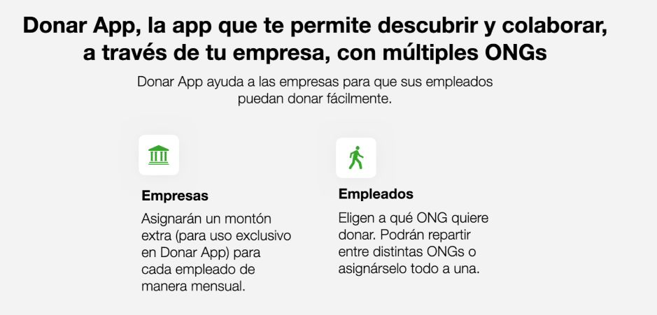
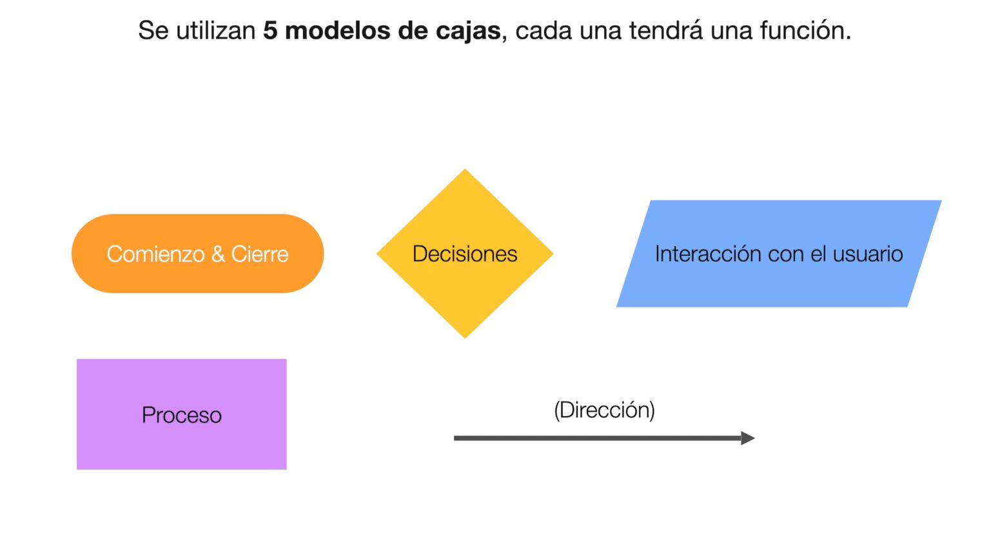
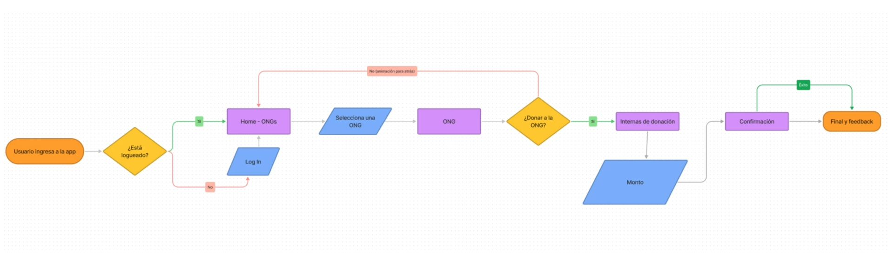
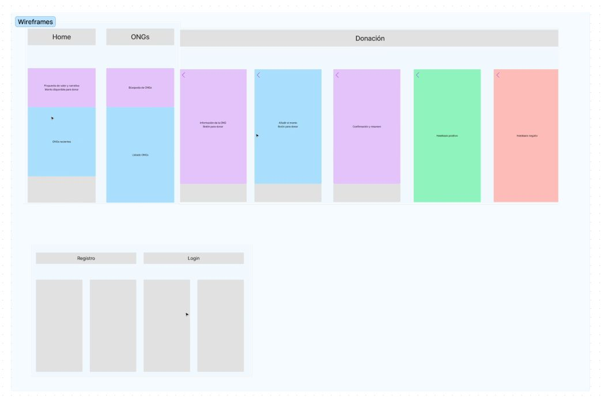
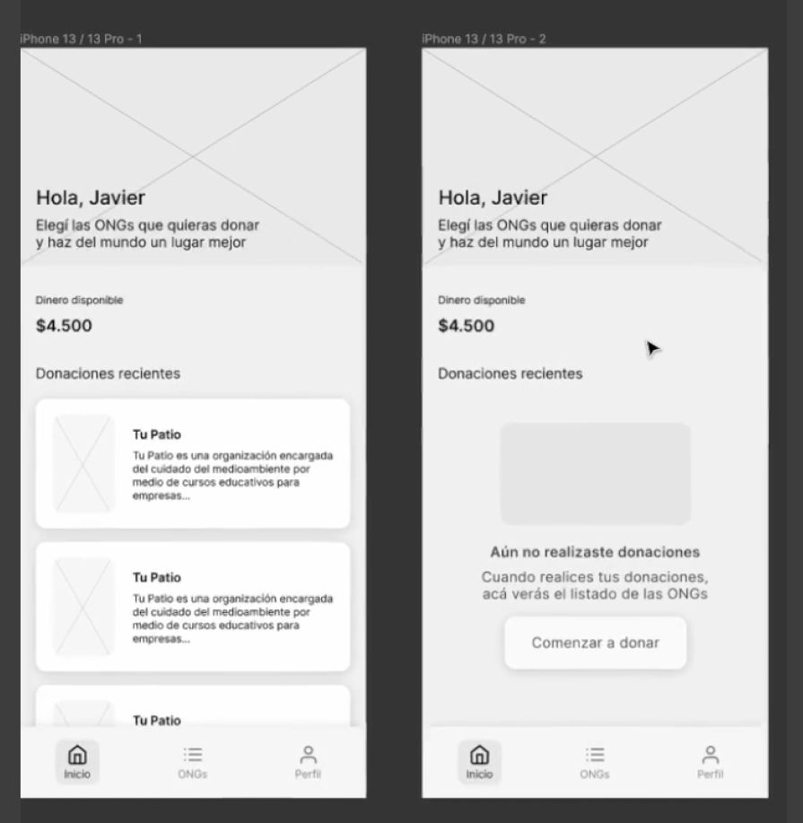
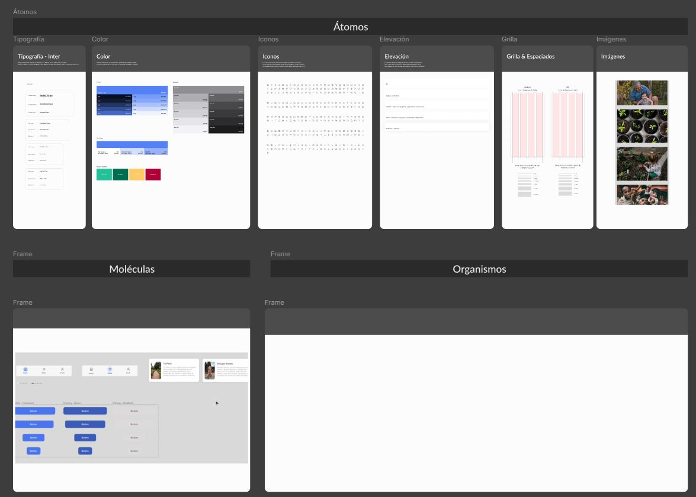
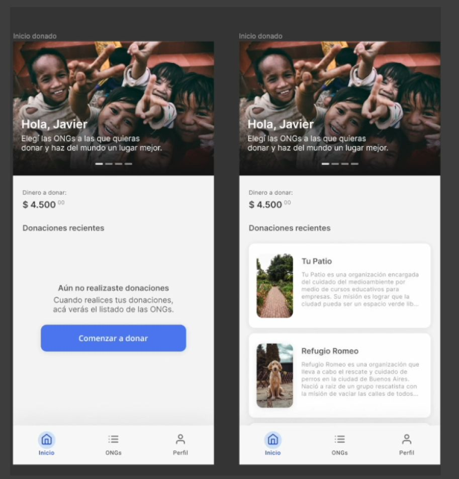

# Proyecto

<br>

**Contenidos**
---

1. [Enunciado](#1-enunciado)
2. [Pasos a seguir](#2-pasos-a-seguir)
   1. [Definir los objetivos del proyecto](#21-definir-los-objetivos-del-proyecto)
   2. [Análisis del público objetivo](#22-análisis-del-público-objetivo)
   3. [Estudio de la competencia](#23-estudio-de-la-competencia)
   4. [Navegación, arquitectura de la información y *user flow*](#24-navegación-arquitectura-de-la-información-y-user-flow)
   5. [Wireframes](#25-wireframes)
   6. [Realizar un UI Kit](#26-realizar-un-ui-kit)
   7. [Diseño de la interfaz (UI)](#27-diseño-de-la-interfaz-ui)
3. [Documentación del proyecto](#3-documentación-del-proyecto)
4. [Entrega](#4-entrega)
5. [Lista de comprobación](#5-lista-de-comprobación)


## 1. Enunciado

### Visión general

Diseñar el **prototipo de una aplicación de escritorio para Windows de temática libre**, recorriendo todo el proceso de diseño: desde la definición de la idea y el estudio de los usuarios hasta un prototipo interactivo en alta fidelidad.

> **Este diseño es el punto de partida de tu proyecto del curso.** En las unidades siguientes programarás esta misma aplicación en **C# con WPF** y la irás ampliando (componentes, informes, pruebas, documentación e instalador). Por eso la temática es libre, pero tiene que ser una **aplicación de gestión de datos** de un tamaño que puedas programar tú:
>
> - Al menos **dos entidades relacionadas** (por ejemplo, socios y reservas, o productos y pedidos).
> - Para la entidad principal: un **listado con búsqueda o filtro**, un **formulario de alta y edición** y la opción de **borrar**.
> - Datos con **fechas, importes o cantidades** que tenga sentido resumir después en un informe (reservas por mes, ventas por categoría…).
>
> **Las temáticas no se repiten entre alumnos.** Antes de empezar, comunica al profesor tu temática con una breve descripción (qué gestiona la aplicación, quién la usa y sus entidades principales) y **espera a que te la apruebe**. Si ya la ha elegido otra persona, tendrás que proponer otra. Tampoco se puede elegir un club deportivo, porque es la aplicación de ejemplo de los apuntes.
>
> Los ejemplos de este enunciado (Donar App y la propuesta OrienTé) son una aplicación móvil y una página web: sirven para ver el proceso y el nivel de detalle esperado, pero tu diseño es el de una **aplicación de escritorio**, con las pautas y los controles que se ven en el curso.

### Objetivos

1. Crear en **FigJam** la siguiente estructura:
   - Objetivos del proyecto (hipótesis, punto de partida e idea).
   - Análisis del público objetivo.
   - Estudio de la competencia.
   - *User flow*.
2. Crear en **Figma** un **wireframe de baja fidelidad** con las pantallas que aparecen en el *user flow*, cada una en un *frame* de **1280 × 720** (el tamaño de la ventana) organizado en filas y columnas.
3. Crear un **UI Kit** siguiendo el **diseño atómico**, con la siguiente estructura:
   - **Átomos:** tipografía, color, iconos, espaciado y rejilla, e imágenes.
   - **Moléculas:** los controles con su estilo (botones principal y secundario, campo de texto con su etiqueta, casilla, desplegable…).
   - **Organismos:** barra de menús, barra de herramientas, formulario, tabla de datos, cuadro de diálogo…
4. Crear un **prototipo en alta fidelidad** a partir del wireframe, utilizando los componentes del UI Kit.
5. Realizar un **test de usabilidad SUS** del prototipo con al menos dos usuarios y una revisión básica de su accesibilidad.

### Especificaciones

- **Tamaño de la ventana principal: 1280 × 720 píxeles** (un *frame* de Figma con ese tamaño). Es el tamaño de la ventana, no de la pantalla: cabe en cualquier monitor del aula y en un portátil de 1366 × 768 con la barra de tareas. Además, se diseña una versión de la **pantalla principal maximizada a 1920 × 1080** para mostrar cómo se adapta la ventana: qué zonas crecen (la lista de datos, el área de contenido) y cuáles mantienen su tamaño (menús, barras, panel lateral).
- Los **cuadros de diálogo** (confirmaciones, formularios de alta o edición) tienen su propio tamaño, más pequeño que el de la ventana principal.
- **Espaciado y rejilla:** márgenes y separaciones en **múltiplos de 8 píxeles** (4 para ajustes finos), como en el sistema de diseño Fluent de Windows. Cada pantalla se organiza en **filas y columnas** bien definidas: en WPF se convertirán en un panel `Grid`.
- Tendrá como mínimo **una ventana principal y 4 pantallas más**, según el *user flow*: vistas dentro de la ventana principal, ventanas secundarias o cuadros de diálogo.
- Las pantallas estarán **enlazadas entre sí** para que el prototipo sea navegable. Las animaciones son opcionales: en escritorio, las ventanas y los cuadros de diálogo suelen aparecer sin transición.
- Los componentes de la interfaz estarán bien definidos: **barra de título, barra de menús, barra de herramientas, panel lateral de navegación, área de contenido, barra de estado y espacios en blanco**.
- Incluirá **al menos dos tipos de menú** además de la barra de menús principal (por ejemplo, un menú contextual con el botón derecho, el menú desplegable de un botón, unas pestañas o un panel lateral de navegación), con una estructura y un contenido que sigan los estándares (ver el apartado 9.1 de la teoría): opciones agrupadas y separadas, puntos suspensivos en las que abren un diálogo, atajos de teclado visibles y letra subrayada para el acceso con Alt.
- Incluirá los **mensajes que genera la aplicación** en el flujo principal del *user flow*: al menos un **mensaje de error** de un formulario, una **confirmación** antes de una acción importante o irreversible, un **aviso de éxito** y un **estado vacío** (una pantalla o sección sin datos todavía).

Además del prototipo, hay que elaborar la **documentación del proyecto** en **Markdown**, en el propio repositorio de entrega, explicando las decisiones de diseño (ver [Documentación del proyecto](#3-documentación-del-proyecto) y [Entrega](#4-entrega)).

### Figma y FigJam

El proyecto se hace con **Figma** y **FigJam** (su pizarra colaborativa), con una cuenta gratuita. **Su manejo no se explica en clase: forma parte del proyecto aprender a usarlos**, como harás con cualquier herramienta nueva en tu trabajo. Para ello, consulta la documentación oficial, el Centro de ayuda de Figma (help.figma.com), y sus tutoriales.

Estas son las funciones que tienes que usar (busca cada una por su nombre en la documentación):

| Función | Para qué la usarás en el proyecto |
| --- | --- |
| **Marcos** (*frames*) de tamaño personalizado | Cada pantalla: la ventana de 1280 × 720, la versión maximizada de 1920 × 1080 y los cuadros de diálogo con su tamaño. |
| **Cuadrículas de diseño** (*layout grids*) | Las filas y columnas de cada pantalla y el espaciado en múltiplos de 8. |
| **Estilos** o **variables** de color y de texto | Los átomos del UI Kit: la paleta y la tipografía, definidas una vez y reutilizadas. |
| **Componentes**, **instancias** y **variantes** | Las moléculas y los organismos del UI Kit, con sus estados (normal, al pasar el ratón, deshabilitado, con el foco). |
| ***Auto layout*** | Barras, formularios y listas que se reorganizan solos al añadir elementos o al cambiar el tamaño. |
| **Prototipado:** conexiones, ***overlays*** y punto de inicio del flujo | Enlazar las pantallas y mostrar menús desplegables, menús contextuales y cuadros de diálogo sobre la ventana. |
| **Modo presentación** y **compartir** | Probar el prototipo, hacer el test SUS y obtener el enlace que se entrega. |
| **Copia local** del fichero | Descargar los ficheros `.fig` (Figma) y `.jam` (FigJam) que se suben al repositorio. |
| FigJam: **notas adhesivas**, **secciones** y la plantilla ***Flow chart*** | La investigación (objetivos, público, competencia) y el *user flow*. |

Pon nombres descriptivos a las páginas, los marcos, las capas y los componentes (`Ventana principal`, `Diálogo – Nueva reserva`, `Botón/Principal`…), no los que pone Figma por defecto (*Frame 1*, *Rectangle 2*): también se evalúa.


## 2. Pasos a seguir

Este apartado describe el proceso que seguiremos para diseñar el proyecto, desde la idea inicial hasta el prototipo en alta fidelidad. Cada paso se apoya en el anterior, así que conviene no saltarse ninguno: un buen diseño visual no salva una idea mal definida ni una navegación confusa.

A lo largo de este apartado se muestran ejemplos de un proyecto real, **Donar App**, una aplicación para que los empleados de una empresa puedan donar a distintas ONG.

> **Ojo:** Donar App es una aplicación **móvil**, mientras que tu proyecto es una **aplicación de escritorio para Windows** (ventana de 1280 × 720). Los ejemplos sirven para ver el proceso y el nivel de detalle esperado en cada fase, no el formato de las pantallas.

> Los pasos 2.1 a 2.4 se documentan en **FigJam** (la pizarra colaborativa de Figma); los pasos 2.5 a 2.7, en **Figma**. Mapea y documenta todo desde el principio: cada decisión que tomes en las primeras fases justificará las de las siguientes.


### 2.1 Definir los objetivos del proyecto

Antes de dibujar nada hay que tener claro qué se quiere conseguir:

- **Propósito:** identificar para qué sirve la aplicación, quién la usa y qué datos gestiona.
- **Metas específicas:** qué se espera lograr con ella (ahorrar tiempo en una tarea, evitar errores al introducir datos, tener la información a mano para tomar decisiones, etc.).
- **Hipótesis y punto de partida:** la necesidad o el problema detectado del que parte el proyecto.
- **La idea:** la propuesta concreta que da respuesta a esa hipótesis.

**Ejemplo — hipótesis y punto de partida:**

> *Las personas quieren trabajar en empresas que tengan un impacto positivo en la sociedad.* Muchas empresas eligen donar un porcentaje de sus ganancias a ONG. Nuestra idea es delegar la responsabilidad de elegir cómo donar ese dinero en las personas que las componen.

**Ejemplo — la idea:**

<p align="center">
  
</p>

Fíjate en que la idea se explica en una sola frase y después se concreta qué hace cada tipo de usuario (empresas y empleados). Si no eres capaz de resumir tu idea así, todavía no está suficientemente definida.


### 2.2 Análisis del público objetivo

- Investigar las **necesidades, preferencias y comportamientos** del usuario final.
- Crear **perfiles de usuario** (*personas*) y **escenarios de uso**.

Una *persona* es un usuario ficticio, pero realista, que representa a un grupo de usuarios reales. Suele incluir una foto, nombre, edad, profesión y una breve descripción de su situación, sus motivaciones y sus frustraciones. Diseñar pensando en "Julia" o en "Jorge" es mucho más útil que diseñar para un genérico "el usuario".

**Ejemplo — nuestras personas tipo:** en Donar App se definieron dos perfiles muy distintos:

| Persona | Perfil |
| --- | --- |
| **Julia**, 33 años | Trabaja en recursos humanos en una gran empresa de alimentación. Muy comprometida con el medio ambiente: se mueve en bicicleta y evita los plásticos. |
| **Jorge**, 51 años | Gerente en un banco, donde gestiona equipos de desarrollo. Muy pendiente de las noticias y preocupado por la situación económica del país. |

Dos personas con edades, intereses y relación con la tecnología diferentes obligan a que el diseño funcione para ambas.


### 2.3 Estudio de la competencia

- Analizar **aplicaciones similares** (de escritorio, web o móviles) para identificar buenas prácticas y áreas de mejora.

Al analizar cada competidor conviene:

- Entender el **producto**: qué ofrece y a quién.
- Entender el **proceso**: qué pasos sigue el usuario para conseguir su objetivo.
- Localizar sus **puntos débiles** (*pain points*) para encontrar áreas de mejora.
- Anotar qué **nos puede servir** y qué cosas **no**.

**Ejemplo — entorno y proceso:** para Donar App se analizaron las webs y aplicaciones de donación de varias ONG conocidas, capturando sus pantallas principales para comparar cómo resuelven el proceso de donar (elección de la cantidad, periodicidad, formulario de datos...).


### 2.4 Navegación, arquitectura de la información y *user flow*

- Crear un **mapa de la aplicación** que organice las ventanas y vistas principales y lo que contiene cada una.
- Definir la **estructura de navegación** para asegurar que sea intuitiva.

El ***user flow*** (flujo de usuario) es el trayecto o proceso que realizan los distintos usuarios para llevar a cabo todas las tareas que permite el sistema. Se representa como un diagrama de flujo:

- Utiliza la plantilla ***Flow chart*** de FigJam.
- Utiliza **5 modelos de cajas**, cada una con una función:

<p align="center">
  
</p>

| Forma | Significado |
| --- | --- |
| Óvalo (naranja) | **Comienzo y cierre** del flujo |
| Rombo (amarillo) | **Decisión**: el flujo se divide según la respuesta (sí / no) |
| Paralelogramo (azul) | **Interacción con el usuario**: el usuario introduce datos o elige una opción |
| Rectángulo (violeta) | **Proceso** que realiza el sistema |
| Flecha | **Dirección** del flujo |

**Ejemplo — *user flow*:**

<p align="center">
  
</p>

Cada pantalla que aparezca en el *user flow* tendrá que diseñarse después en el wireframe, así que este diagrama es también la lista de pantallas del proyecto.


### 2.5 Wireframes

- Desarrollar **wireframes de baja fidelidad** para representar la disposición de los elementos en cada pantalla.

En esta fase lo que cuenta es **cómo se organiza el contenido**, no el aspecto final. Cajas grises, textos de relleno y aspas en lugar de imágenes son suficientes (los símbolos habituales están en el apartado 7.1 de la teoría). Con la práctica, los wireframes irán ganando detalle y precisión.

Aunque sea de baja fidelidad, **cada pantalla se dibuja ya en un *frame* de 1280 × 720** (los cuadros de diálogo, en uno de su tamaño) y se organiza en **filas y columnas**. Los tamaños de los controles y las separaciones pueden ser aproximados, pero la distribución tiene que ser la real: así, en la alta fidelidad solo se sustituyen las cajas grises por los componentes del UI Kit, sin tener que rehacer la pantalla.

**Ejemplo — estructura en baja fidelidad:** primero se plantea la estructura general de las pantallas del *user flow* y cómo se relacionan.

<p align="center">
  
</p>

**Ejemplo — primeros wireframes:** después se dibuja cada pantalla con su contenido.

<p align="center">
  
</p>


### 2.6 Realizar un UI Kit

- Crear un **conjunto de elementos visuales coherentes** que puedan reutilizarse en todas las pantallas del proyecto.

El UI Kit se organiza siguiendo el **diseño atómico**: primero los **átomos** (tipografía, color, iconos, espaciado, imágenes), con ellos las **moléculas** (un campo de formulario con su etiqueta, un botón con icono...) y con estas los **organismos** (una barra de herramientas, un formulario completo, un cuadro de diálogo...).

En WPF, el UI Kit se convertirá en un **diccionario de recursos** con los colores, las fuentes y los estilos de los controles, y los organismos que se repiten, en **controles de usuario** reutilizables. Cuanto más ordenado esté, más fácil será programarlo.

<p align="center">
  
</p>


### 2.7 Diseño de la interfaz (UI)

- Definir la **paleta de colores, las tipografías y el estilo visual** en consonancia con la identidad de la marca.
- Diseñar las **pantallas clave** con todos los elementos visuales (botones, imágenes, menús).
- Diseñar los **menús** y los **mensajes** de la aplicación (errores, confirmaciones, avisos de éxito y estados vacíos). Un buen mensaje es **breve**, dice **qué ha pasado** y **qué puede hacer el usuario**, y usa el lenguaje del usuario, no el del sistema: «El correo no tiene un formato válido. Ejemplo: nombre@dominio.es» es mejor que «Error 422: invalid input».
- Crear **prototipos interactivos** que simulen el flujo de interacción definido en el *user flow*.

**Ejemplo — del wireframe a la alta fidelidad:**

| Wireframe (baja fidelidad) | Diseño final (alta fidelidad) |
| --- | --- |
|  |  |

Las dos versiones tienen exactamente la misma estructura: el diseño en alta fidelidad no cambia la organización del contenido, sino que la "viste" con los componentes del UI Kit.

## 3. Documentación del proyecto

Junto al prototipo se elaborará la **documentación del proyecto**, que explica y justifica las decisiones tomadas. Se escribe en **Markdown** en el repositorio de entrega (ver [Entrega](#4-entrega)), con capturas de pantalla y, si ayudan, vídeos o GIF animados del prototipo. Debe incluir los siguientes apartados:

| Apartado | Qué hay que incluir |
| --- | --- |
| **Temática y objetivos** | Descripción de la temática elegida, hipótesis de partida, propósito de la aplicación, datos que gestiona y metas que se quieren alcanzar. |
| **Competencia y referentes** | Estudio de la competencia y de las aplicaciones de referencia. |
| **Estándares de usabilidad y accesibilidad** | Estudio breve: identificar los principales estándares de usabilidad y accesibilidad que se aplican al proyecto (por ejemplo, las heurísticas de Nielsen, las pautas WCAG, las guías de diseño de aplicaciones de Windows o los estándares de facto de las aplicaciones de escritorio) y explicar por qué es importante seguirlos, indicando con algún ejemplo dónde se han aplicado en el prototipo. |
| **Imágenes** | Selección de imágenes acordes a la temática. |
| **Color dominante** | Un color dominante asociado a la temática, explicando por qué se ha elegido. |
| **Paleta de colores** | Paleta construida a partir del color dominante: **monocromática, análoga o complementaria**. Explicar el uso de cada color y su proporción, con una captura de pantalla. |
| **Tipografía** | Fuente elegida para el prototipo y por qué. Combinación armónica con una segunda fuente, aplicando distintos pesos para crear la jerarquía visual. |
| **Contraste** | Dos colores para el texto y el fondo, calculando su **relación de contraste según WCAG 2**. |
| **Equilibrio y tensión** | Varios ejemplos de **equilibrio visual y tensión compositiva** aplicados en el diseño, explicando por qué se han elegido esos elementos y qué significado aportan. |
| **Menús** | Tipos de menú usados (principal y al menos otros dos), qué estándar o convención sigue cada uno (posición, orden de las opciones, agrupación, opción activa resaltada, atajos de teclado si los hay) y por qué se ha elegido cada tipo, con capturas. |
| **Mensajes de la aplicación** | Inventario de los mensajes del prototipo (error, confirmación, éxito y estado vacío) con una captura de cada uno, explicando cómo se ha comprobado que son **adecuados en extensión y claridad** (por ejemplo, revisándolos con las heurísticas de Nielsen 1 y 9, o preguntando a los usuarios del test SUS si los entendieron). |
| **Tamaño de la ventana y rejilla** | Ventana principal de 1280 × 720 y su versión maximizada a 1920 × 1080 (qué crece y qué se mantiene), tamaño de los cuadros de diálogo, espaciado en múltiplos de 8 y organización de cada pantalla en filas y columnas. |
| **Pruebas de usabilidad y accesibilidad** | Resultados del test SUS con al menos dos usuarios (respuestas y puntuación de cada uno), conclusiones y mejoras aplicadas al prototipo a partir de ellas. Revisión básica de accesibilidad: simulación de daltonismo, tamaño de los elementos pulsables y uso con teclado (orden de tabulación, atajos y teclas de acceso). |

### El test SUS

El **SUS** (*System Usability Scale*) es un cuestionario de diez afirmaciones que el usuario valora de 1 (*totalmente en desacuerdo*) a 5 (*totalmente de acuerdo*) después de usar el prototipo:

1. Creo que me gustaría usar esta aplicación con frecuencia.
2. He encontrado la aplicación innecesariamente compleja.
3. He pensado que la aplicación era fácil de usar.
4. Creo que necesitaría la ayuda de una persona con conocimientos técnicos para poder usar esta aplicación.
5. He encontrado que las distintas funciones de la aplicación estaban bien integradas.
6. He pensado que había demasiada inconsistencia en esta aplicación.
7. Imagino que la mayoría de las personas aprenderían a usar esta aplicación muy rápidamente.
8. He encontrado la aplicación muy difícil de usar.
9. Me he sentido muy seguro/a usando la aplicación.
10. He necesitado aprender muchas cosas antes de poder manejarme con la aplicación.

**Cálculo de la puntuación** (de 0 a 100):

- A cada respuesta **impar** (afirmaciones positivas) se le resta 1.
- A 5 se le resta cada respuesta **par** (afirmaciones negativas).
- Se suman los diez valores obtenidos y el total se multiplica por **2,5**.

Como referencia, una puntuación por encima de **68** se considera una usabilidad por encima de la media.

Para que la prueba sea útil, conviene que los usuarios intenten realizar alguna tarea concreta del *user flow* (por ejemplo, hacer una reserva) antes de responder, y anotar también sus comentarios y las dificultades observadas: son la base para decidir qué mejorar.

### Ejemplo de buena práctica

El documento **Propuesta de prototipo web: OrienTé**, que encontrarás en la carpeta de este enunciado del proyecto (`ejemplo-propuesta-proyecto-oriente.pdf`), es un ejemplo de documentación bien resuelta (en PDF; la tuya va en Markdown, pero el contenido esperado es el mismo). Propone la **web** de un salón de té (tu proyecto es una aplicación de escritorio, así que algunos apartados cambian: tamaño de la ventana, menús, mensajes), pero recorre todos los apartados anteriores:

- Una **hipótesis de partida** bien argumentada (por qué los salones de té tienen menos presencia que las cadenas de cafeterías), con propósito y metas concretas.
- Un **análisis de la competencia** con puntos fuertes y puntos a mejorar de cada sitio, además de varios sitios de referencia.
- Un **color dominante** tomado del logotipo, una **paleta monocromática** justificada y capturas que muestran dónde se usa cada color.
- Una **combinación tipográfica** razonada (Inter para títulos y Montserrat para el contenido).
- El **cálculo del contraste** entre texto y fondo, tanto del conjunto de la web como de la carta del menú.
- Ejemplos de **equilibrio visual** por posición, tamaño y color sobre las propias pantallas del prototipo.
- Un apartado adicional de **accesibilidad y usabilidad** que incluye un **test SUS** con dos usuarios y su puntuación.

Fíjate sobre todo en que cada decisión va acompañada de su **porqué**: eso es lo que diferencia una documentación que simplemente describe el diseño de una que lo justifica.


## 4. Entrega

El proyecto se entrega en el **repositorio de entrega** de la tarea, con esta estructura:

```text
README.md                ← la documentación del proyecto, con índice
figma/
├── <nombre>.fig         ← wireframe, UI Kit y prototipo (copia local de Figma)
└── <nombre>.jam         ← investigación y user flow (copia local de FigJam)
img/                     ← capturas de pantalla
video/                   ← vídeos o GIF del prototipo (opcional)
```

- **`README.md`:** empieza con el nombre y la temática de la aplicación, el **enlace al prototipo** y un **índice** enlazado a los apartados de la [documentación](#3-documentación-del-proyecto). Si queda muy largo, puedes dividirlo en varios ficheros Markdown dentro de una carpeta `docs/`, enlazados desde el índice.
- **Enlace al prototipo:** el del **modo presentación**, empezando en la ventana principal y con acceso para **cualquiera con el enlace**. Compruébalo en una ventana privada del navegador, sin iniciar sesión: si no se abre, no se puede evaluar.
- **Ficheros de Figma y FigJam:** la copia local de cada uno, con la versión final. No modifiques el diseño en Figma después de entregar: el enlace al prototipo muestra siempre la versión actual, y tiene que coincidir con la del repositorio.
- **Imágenes y vídeos:** cada imagen con su **texto alternativo** y un tamaño en el que se lea bien. Investiga cómo se muestra un vídeo o un GIF en un `README.md` de GitHub y procura que pesen poco (vídeos cortos, de unos segundos, que muestren un recorrido concreto).
- **No se entrega un PDF aparte.** Si además quieres tener la documentación en PDF, genérala a partir del propio repositorio (investiga qué herramientas convierten Markdown en PDF) y añádela; lo que se corrige es el repositorio.


## 5. Lista de comprobación

Antes de dar el proyecto por terminado, comprueba que incluye todo lo siguiente:

- [ ] FigJam con objetivos (hipótesis, punto de partida e idea), público objetivo, competencia y *user flow*.
- [ ] Wireframe de baja fidelidad en Figma con todas las pantallas del *user flow*, en *frames* de 1280 × 720 organizados en filas y columnas.
- [ ] Temática aprobada por el profesor y de gestión de datos, con al menos dos entidades relacionadas, listado con búsqueda, alta, edición y borrado, y datos que se puedan resumir en un informe.
- [ ] UI Kit con átomos (tipografía, color, iconos, espaciado, imágenes), moléculas (controles) y organismos.
- [ ] Prototipo en alta fidelidad con la ventana principal a 1280 × 720 (y la pantalla principal maximizada a 1920 × 1080), espaciado en múltiplos de 8, construido con los componentes del UI Kit.
- [ ] Ventana principal y al menos 4 pantallas más, enlazadas (prototipo navegable).
- [ ] Barra de título, barra de menús, barra de herramientas, panel lateral, área de contenido, barra de estado y espacios en blanco bien definidos.
- [ ] Barra de menús y al menos otros dos tipos de menú, siguiendo los estándares.
- [ ] Mensajes de error, confirmación, éxito y estado vacío en el prototipo.
- [ ] Estudio breve de los estándares de usabilidad y accesibilidad aplicados.
- [ ] Test SUS con al menos dos usuarios, con su puntuación, conclusiones y mejoras, y revisión básica de accesibilidad.
- [ ] Documentación en Markdown en el `README.md` del repositorio, con índice y todos los apartados de la [documentación](#3-documentación-del-proyecto).
- [ ] Copias locales de Figma (`.fig`) y FigJam (`.jam`) en `figma/`, con la versión final.
- [ ] Enlace al prototipo en modo presentación, comprobado en una ventana privada sin iniciar sesión.
- [ ] Páginas, marcos, capas y componentes con nombres descriptivos.


<br>
