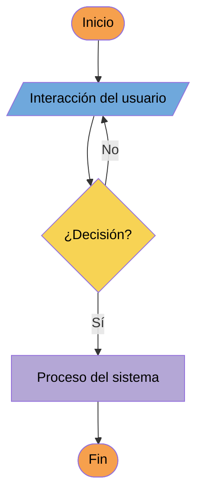

# 4. Navegación y *user flow*

## Mapa de la aplicación

<!-- Ventanas y vistas principales y qué contiene cada una, como lista anidada o como diagrama Mermaid. -->

## *User flow*

<!-- Diagrama Mermaid (flowchart) con las cinco formas del apartado 2.4 del enunciado y sus colores: el flujo principal y los caminos alternativos (errores, confirmaciones, búsquedas sin resultados). Si queda muy grande, haz un diagrama por tarea, cada uno con su título. Sustituye el diagrama de ejemplo, pero conserva las líneas classDef. -->

## Pantallas

<!-- Todas las pantallas del prototipo, una fila por frame de Figma y con el mismo nombre que el frame. Tipo: vista (dentro de la ventana principal), ventana o diálogo. Captura: el PNG del frame exportado a 1x en img/pantallas/, con el número y el nombre de la pantalla en minúsculas y con guiones. Lleva a: los números de las pantallas a las que se llega desde esta y con qué acción (por ejemplo, «04 (botón Nuevo)»). -->

| N.º | Pantalla | Tipo | Tamaño (px) | Captura | Lleva a |
| --- | --- | --- | --- | --- | --- |
| 01 | Ventana principal | Ventana | 1280 × 720 | `01-ventana-principal.png` |  |
| 02 | Ventana principal maximizada | Ventana | 1920 × 1080 | `02-ventana-principal-maximizada.png` |  |
|  |  |  |  |  |  |

### Capturas

<!-- Cada captura de la tabla, en el mismo orden, con su texto alternativo. -->
